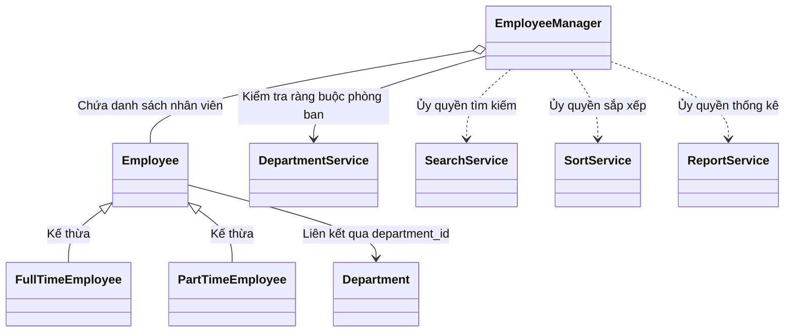

# BÁO CÁO BÀI TẬP LỚN MÔN HỌC LẬP TRÌNH PYTHON (INT13162)
## ĐỀ TÀI 01: HỆ THỐNG QUẢN LÝ NHÂN VIÊN (EMPLOYEE MANAGEMENT SYSTEM)

**Giảng viên hướng dẫn:** ThS. Nguyễn Sơn Huy  
**Nhóm thực hiện:** Nhóm 1  
**Học kỳ / Năm học:** Học kỳ I – Năm học 2026–2027  

---

## BẢNG PHÂN CÔNG VÀ KẾT QUẢ THỰC HIỆN CỦA CÁC THÀNH VIÊN

| STT | Họ và tên | Mã sinh viên | Gói phụ trách | Vai trò & Nhiệm vụ chính | Đánh giá hoàn thành |
|:---:|---|---|:---:|---|:---:|
| 1 | **Nguyễn Sỹ Huy** | `[MSSV_LEAD]` | **Lead & Gói F** | Trưởng nhóm, kiến trúc sư hệ thống, dựng base, review PR, vẽ UML, dựng tài liệu & báo cáo | 100% |
| 2 | **Nông Quang Vinh** | `[MSSV_A]` | **Gói A** | Xây dựng mô hình thực thể nhân viên: `Employee`, `FullTimeEmployee`, `PartTimeEmployee`, `Factory`, bộ `validators` | 100% |
| 3 | **Mạnh Thảo** | `[MSSV_B]` | **Gói B** | Xây dựng thực thể `Department`, dịch vụ `DepartmentService`, nghiệp vụ chuyển phòng ban & ràng buộc xóa | 100% |
| 4 | **Phạm Hải** | `[MSSV_C]` | **Gói C** | Xây dựng lớp quản trị `EmployeeManager`, xử lý nghiệp vụ CRUD (Thêm, Sửa, Xóa, Hiển thị danh sách) | 100% |
| 5 | **Minh Dương** | `[MSSV_D]` | **Gói D** | Xây dựng dịch vụ tìm kiếm `SearchService`, sắp xếp `SortService`, định dạng bảng dữ liệu `formatter` | 100% |
| 6 | **Phạm Quang Đạt** | `[MSSV_E]` | **Gói E** | Xây dựng dịch vụ thống kê `ReportService`, lưu trữ dữ liệu JSON `FileStorage`, tính năng mở rộng xuất file CSV | 100% |

---

## MỤC LỤC BÁO CÁO

1. [MỤC 1: MÔ TẢ BÀI TOÁN VÀ MỤC TIÊU HỆ THỐNG](#1-mô-tả-bài-toán-và-mục-tiêu-hệ-thống)
2. [MỤC 2: PHÂN TÍCH THIẾT KẾ HƯỚNG ĐỐI TƯỢNG VÀ CÁC LỚP](#2-phân-tích-thiết-kế-hướng-đối-tượng-và-các-lớp)
3. [MỤC 3: GIẢI THÍCH CÁC NGUYÊN LÝ LẬP TRÌNH HƯỚNG ĐỐI TƯỢNG (OOP)](#3-giải-thích-các-nguyên-lý-lập-trình-hướng-đối-tượng-oop)
4. [MỤC 4: HƯỚNG DẪN CÀI ĐẶT VÀ VẬN HÀNH CHƯƠNG TRÌNH](#4-hướng-dẫn-cài-đặt-và-vận-hành-chương-trình)
5. [MỤC 5: TỔ CHỨC DỰ ÁN VÀ QUẢN LÝ TIẾN ĐỘ TRÊN GITHUB](#5-tổ-chức-dự-án-và-quản-lý-tiến-độ-trên-github)
6. [MỤC 6: HÌNH ẢNH MINH HỌA CÁC CHỨC NĂNG CHÍNH](#6-hình-ảnh-minh-họa-các-chức-năng-chính)
7. [MỤC 7: BẢNG KỊCH BẢN KIỂM THỬ HỆ THỐNG (TEST CASES)](#7-bảng-kịch-bản-kiểm-thử-hệ-thống-test-cases)
8. [MỤC 8: CÁC CHỨC NĂNG MỞ RỘNG (EXTENSIONS)](#8-các-chức-năng-mở-rộng-extensions)
9. [MỤC 9: KẾT LUẬN VÀ HƯỚNG PHÁT TRIỂN](#9-kết-luận-và-hướng-phát-triển)

---

## 1. MÔ TẢ BÀI TOÁN VÀ MỤC TIÊU HỆ THỐNG

### 1.1. Bối cảnh và Đặt vấn đề
Trong quản trị doanh nghiệp hiện đại, nguồn nhân lực là tài sản cốt lõi. Việc quản lý thông tin nhân sự đòi hỏi tính chính xác, nhất quán, bảo mật và hỗ trợ xử lý linh hoạt cho nhiều đối tượng lao động khác nhau (nhân viên chính thức toàn thời gian, nhân viên cộng tác bán thời gian). Đề tài "Quản lý nhân viên" đặt ra yêu cầu xây dựng một hệ thống phần mềm hoàn chỉnh bằng ngôn ngữ Python, áp dụng triệt để phương pháp lập trình hướng đối tượng (OOP), hoạt động trên giao diện dòng lệnh Console với menu điều khiển trực quan, ngăn chặn sự cố sập ứng dụng và đảm bảo toàn vẹn dữ liệu.

### 1.2. Mục tiêu kỹ thuật
- **Tuân thủ chuẩn thiết kế OOP:** Áp dụng đầy đủ 4 trụ cột hướng đối tượng: Đóng gói (Encapsulation), Kế thừa (Inheritance), Đa hình (Polymorphism) và Trừu tượng (Abstraction) qua lớp trừu tượng `ABC`.
- **Kiến trúc phân tầng sạch (Clean Architecture):** Tách bạch rõ rệt giữa:
  - Tầng thực thể dữ liệu (`models/`): Tuyệt đối không chứa logic giao tiếp người dùng (`print`/`input`).
  - Tầng nghiệp vụ xử lý (`services/`): Đảm nhiệm toàn bộ quy tắc nghiệp vụ, tính toán, kiểm soát toàn vẹn.
  - Tầng lưu trữ dữ liệu (`storage/`): Đọc và ghi file dữ liệu an toàn.
  - Tầng giao diện điều khiển (`ui/`): Nơi duy nhất xử lý tương tác hiển thị và nhận lệnh từ bàn phím.
- **Khả năng cộng tác nhóm không xung đột (Conflict-Free Collaboration):** Phân chia gói việc A–F với ranh giới file rõ ràng ("Một file một chủ"), quản lý theo quy trình Git chuẩn mực (nhánh tính năng, Pull Request, bảo vệ nhánh `main`).

---

## 2. PHÂN TÍCH THIẾT KẾ HƯỚNG ĐỐI TƯỢNG VÀ CÁC LỚP

### 2.1. Sơ đồ lớp tổng thể (Class Diagram)
Hệ thống được thiết kế với cấu trúc phân rã thành các gói chức năng chặt chẽ:

*(Tham khảo chi tiết tại `docs/uml/class_diagram.md` và mã nguồn PlantUML `docs/uml/class_diagram.puml`)*



### 2.2. Chi tiết các lớp thực thể (Entity Models)
1. **Lớp trừu tượng `Employee` (`models/employee.py`):**
   - Thuộc tính private: `__employee_id`, `__full_name`, `__birth_year`, `__department_id`, `__base_salary`.
   - Thuộc tính bất biến (Immutable): `employee_id` chỉ có getter, không có setter nhằm ngăn chặn việc tự ý thay đổi mã định danh nhân viên sau khi đã khởi tạo (R14).
   - Phương thức trừu tượng: `@abstractmethod calculate_salary()`, `@property employee_type`.
   - Phương thức dùng chung: `to_dict()`, `display_info()`, `__str__()`, `__repr__()`.

2. **Lớp `FullTimeEmployee` (`models/fulltime.py`):**
   - Kế thừa lớp `Employee`.
   - Thuộc tính bổ sung: `allowance` (phụ cấp hàng tháng, $\ge 0$).
   - Cài đặt phương thức tính lương:
     $$\text{Lương} = \text{base\_salary} + \text{allowance}$$

3. **Lớp `PartTimeEmployee` (`models/parttime.py`):**
   - Kế thừa lớp `Employee`.
   - Thuộc tính bổ sung: `hours_worked` (số giờ làm trong tháng, $0 \le \text{hours\_worked} \le 300$) và `hourly_rate` (đơn giá theo giờ, $\ge 0$).
   - Thuộc tính `base_salary` kế thừa có giá trị mặc định là $0$ và không tham gia tính toán.
   - Cài đặt phương thức tính lương:
     $$\text{Lương} = \text{hours\_worked} \times \text{hourly\_rate}$$

4. **Lớp `Department` (`models/department.py`):**
   - Đại diện cho phòng ban quản lý trong công ty.
   - Thuộc tính: `department_id` (mã phòng ban in hoa, 3-10 ký tự), `department_name` (tên phòng ban 2-50 ký tự).

### 2.3. Chi tiết các lớp dịch vụ và điều khiển (Services)
1. **Lớp `EmployeeManager` (`services/employee_manager.py`):**
   - Tách biệt hoàn toàn khỏi thực thể `Employee` để tuân thủ nguyên lý đơn trách nhiệm (Single Responsibility Principle).
   - Quản lý danh bạ nhân viên nội bộ `_employees: dict[str, Employee]`.
   - Thực hiện kiểm tra trùng lặp mã (ném `DuplicateIdError`), kiểm tra sự tồn tại của phòng ban thông qua `DepartmentService` (ném `NotFoundError`).
   - Cung cấp cơ chế cập nhật thông tin "Tất cả hoặc không gì" (Atomic update): nếu 1 trường dữ liệu bất kỳ bị lỗi, toàn bộ trạng thái ban đầu của đối tượng được giữ nguyên vẹn.

2. **Lớp `DepartmentService` (`services/department_service.py`):**
   - Quản lý danh mục phòng ban `_departments: dict[str, Department]`.
   - Kiểm soát toàn vẹn nghiệp vụ: từ chối xóa phòng ban khi còn nhân viên trực thuộc (ném `BusinessRuleError` nêu rõ số lượng nhân viên).
   - Xử lý chuyển phòng ban: từ chối nếu chuyển sang đúng phòng ban hiện tại hoặc phòng ban đích không tồn tại.

3. **Các lớp tiện ích chức năng chuyên biệt:**
   - `SearchService`: Tìm kiếm mã chính xác và tìm kiếm gần đúng tên theo cơ chế không phân biệt hoa/thường và hỗ trợ tiếng Việt không dấu.
   - `SortService`: Sắp xếp danh sách nhân viên theo tiêu chí đa dạng (`salary`, `name`, `id`, `birth_year`) với tính chất sắp xếp ổn định (Stable Sort), xếp tên tiếng Việt chuẩn theo từ cuối của họ tên.
   - `ReportService`: Tổng hợp quỹ lương, tính lương trung bình, tìm nhân viên thu nhập cao nhất (xử lý đồng hạng) và thống kê tỷ trọng nhân sự theo phòng ban/loại hình.

---

## 3. GIẢI THÍCH CÁC NGUYÊN LÝ LẬP TRÌNH HƯỚNG ĐỐI TƯỢNG (OOP)

Dự án áp dụng chặt chẽ 4 nguyên lý cốt lõi của lập trình hướng đối tượng:

### 3.1. Tính Đóng Gói (Encapsulation)
- Toàn bộ trường dữ liệu của `Employee` và `Department` đều được khai báo với phạm vi truy cập nội bộ (private, bắt đầu bằng hai dấu gạch dưới `__`).
- Quyền truy xuất được công khai thông qua cơ chế `@property` (getter) và setter có gắn kèm bộ kiểm tra dữ liệu (`validators`).
- Dữ liệu đầu vào bắt buộc phải đi qua các hàm kiểm tra tính hợp lệ: họ tên không chứa ký tự số/đặc biệt, năm sinh đảm bảo độ tuổi lao động từ 18 đến 65, số giờ làm và đơn giá không âm. Mọi vi phạm đều bị chặn đứng bằng các lớp ngoại lệ tự định nghĩa.

### 3.2. Tính Kế Thừa (Inheritance)
- Hệ thống thiết kế một cây phả hệ kế thừa rõ ràng: `Employee` là lớp cơ sở (lớp cha), `FullTimeEmployee` và `PartTimeEmployee` là các lớp dẫn xuất (lớp con).
- Các lớp con tái sử dụng toàn bộ mã nguồn khởi tạo và thuộc tính chung của lớp cha (`employee_id`, `full_name`, `birth_year`, `department_id`) thông qua hàm `super().__init__(...)`, đồng thời mở rộng thêm các thuộc tính riêng biệt tương ứng với từng hình thức lao động.

### 3.3. Tính Đa Hình (Polymorphism)
- Thể hiện rõ nét qua phương thức `calculate_salary()`:
  - Khi một danh sách hỗn hợp chứa cả nhân viên toàn thời gian và bán thời gian được duyệt qua một vòng lặp:
    ```python
    for emp in employees:
        salary = emp.calculate_salary()
    ```
  - Trình thông dịch Python sẽ tự động định tuyến và gọi đúng phương thức của lớp cụ thể mà không cần sử dụng bất kỳ câu lệnh điều kiện `if/else` nào để kiểm tra loại đối tượng.
- Tính đa hình còn thể hiện trong các phương thức chuyển đổi dữ liệu `to_dict()`, `__str__()` khi lớp con mở rộng logic hiển thị của lớp cha bằng cách gọi `super()`.

### 3.4. Tính Trừu Tượng (Abstraction)
- Lớp `Employee` kế thừa từ `abc.ABC` đóng vai trò là một khuôn mẫu trừu tượng đại diện cho khái niệm nhân viên tổng quát.
- Các phương thức `@abstractmethod` buộc mọi lớp con cụ thể phải có trách nhiệm triển khai logic chi tiết, ngăn cấm hoàn toàn hành vi khởi tạo đối tượng trừu tượng chưa đầy đủ thông tin:
  ```python
  Employee(...) # Sẽ lập tức ném TypeError
  ```

---

## 4. HƯỚNG DẪN CÀI ĐẶT VÀ VẬN HÀNH CHƯƠNG TRÌNH

### 4.1. Yêu cầu môi trường
- Hệ điều hành: Windows 10/11, macOS hoặc Linux.
- Ngôn ngữ: Python phiên bản $\ge 3.10$.
- Thư viện: **100% sử dụng thư viện chuẩn của Python** (`unittest`, `json`, `csv`, `re`, `math`, `datetime`, `dataclasses`, `argparse`, `sys`, `os`), không phụ thuộc bất kỳ gói cài đặt bên ngoài nào qua `pip`.

### 4.2. Các bước vận hành

```bash
# 1. Di chuyển vào thư mục chứa mã nguồn dự án
cd employee_management

# 2. Chạy chương trình với chế độ thông thường (dữ liệu tải từ file)
python main.py

# 3. Chạy chương trình với chế độ nạp dữ liệu mẫu khởi tạo ban đầu (--seed)
python main.py --seed

# 4. Chạy toàn bộ hệ thống kiểm thử tự động (Unit Tests)
python -m unittest discover -s tests -v
```

---

## 5. TỔ CHỨC DỰ ÁN VÀ QUẢN LÝ TIẾN ĐỘ TRÊN GITHUB

### 5.1. Mô hình phân nhánh (Branching Strategy)
- Nhánh `main`: Nhánh ổn định, được thiết lập cơ chế bảo vệ (Branch Protection Rules), chỉ nhận mã nguồn thông qua Pull Request được Trưởng nhóm phê duyệt.
- Các nhánh tính năng riêng biệt:
  - `feature/a-models`: Phát triển các lớp thực thể và bộ validate.
  - `feature/b-department`: Phát triển quản lý phòng ban và luân chuyển nhân sự.
  - `feature/c-crud`: Phát triển các chức năng Thêm, Sửa, Xóa, Hiển thị.
  - `feature/d-search-sort`: Phát triển dịch vụ Tìm kiếm, Sắp xếp, Bảng in.
  - `feature/e-report-extension`: Phát triển Thống kê, Lưu/Đọc JSON, Xuất file CSV.
  - `feature/f-docs`: Xây dựng tài liệu kiến trúc, UML, bảng test case và báo cáo.

### 5.2. Nguyên tắc "Một file một chủ" (Single Ownership)
Mỗi tập tin mã nguồn trong cây thư mục đều được phân định chủ sở hữu duy nhất trong tập tin `.github/CODEOWNERS`. Thành viên tuyệt đối không chỉnh sửa tập tin của người khác, loại bỏ triệt để xung đột mã nguồn (Merge Conflict) khi làm việc song song.

---

## 6. HÌNH ẢNH MINH HỌA CÁC CHỨC NĂNG CHÍNH

*(Các ảnh chụp màn hình minh họa chi tiết được lưu trữ tại thư mục `docs/screenshots/`)*

### 6.1. Giao diện Menu chính

*Hình 6.1: Giao diện Menu điều khiển chính gồm 12 mục chức năng và mục thoát 0*

### 6.2. Chức năng Thêm mới nhân viên

*Hình 6.2: Thao tác thêm mới nhân viên toàn thời gian thành công*


*Hình 6.3: Cơ chế xác thực dữ liệu tức thì, nhập sai trường nào nhập lại ngay tại trường đó*

### 6.3. Chức năng Hiển thị và Tìm kiếm

*Hình 6.4: Hiển thị danh sách nhân viên dạng bảng thẳng hàng, tự động định dạng tiền tệ và tên phòng ban*


*Hình 6.5: Tìm kiếm gần đúng theo họ tên không phân biệt hoa thường và không dấu*

### 6.4. Chức năng Thống kê và Minh họa Đa hình

*Hình 6.6: Báo cáo thống kê tổng quỹ lương, lương cao nhất và phân bố nhân sự theo phòng ban*

---

## 7. BẢNG KỊCH BẢN KIỂM THỬ HỆ THỐNG (TEST CASES)

Hệ thống đã được thiết kế bộ kiểm thử toàn diện gồm 20 ca kiểm thử chuyên sâu bao quát toàn bộ các khía cạnh nghiệp vụ, biên giá trị và ràng buộc quan hệ:

*(Tham khảo bảng chi tiết đầy đủ tại tập tin `docs/test_cases.md`)*

- **Dữ liệu hợp lệ:** Thêm thành công FT (`TC01`), PT (`TC02`), Sắp xếp lương giảm dần (`TC15`), Tìm kiếm gần đúng (`TC17`).
- **Trùng lặp định danh:** Thêm mã đã tồn tại báo `DuplicateIdError` (`TC03`).
- **Dữ liệu không hợp lệ:** Mã rỗng (`TC04`), Họ tên chứa số/ký tự lạ (`TC05`), Lương âm (`TC08`).
- **Trường hợp biên:** Tuổi đúng 18 và 17 tuổi (`TC06`), Giờ làm đúng 300h và 301h (`TC07`).
- **Ràng buộc toàn vẹn quan hệ:** Không xóa phòng ban khi còn nhân viên (`TC18`), Không chuyển nhân viên sang đúng phòng hiện tại (`TC19`), Thêm nhân viên vào phòng ban không tồn tại (`TC10`).
- **Xử lý danh sách rỗng:** Hiển thị an toàn (`TC13`), Thống kê không lỗi chia cho 0 (`TC14`).
- **Kiểm thử tự động (Unit Test):** Tập tin `tests/test_smoke.py` tự động kiểm thử 11 trường hợp nền tảng cốt lõi, chạy qua 100% trong thời gian dưới $0.005$ giây.

---

## 8. CÁC CHỨC NĂNG MỞ RỘNG (EXTENSIONS)

Đáp ứng và vượt tiêu chí của đề bài (yêu cầu ít nhất 02 chức năng mở rộng phù hợp chủ đề), nhóm đã triển khai thành công 2 chức năng nâng cao:

### 8.1. Chức năng mở rộng 1: Lưu trữ và Phục hồi dữ liệu an toàn bằng JSON (`FileStorage`)
- **Mục đích:** Đảm bảo dữ liệu nhân sự và danh mục phòng ban được bảo lưu vĩnh viễn, không bị mất đi khi người dùng tắt chương trình.
- **Kỹ thuật cài đặt an toàn (Atomic File Write):** Hệ thống ghi dữ liệu ra một file tạm trước khi sử dụng `os.replace` để ghi đè sang `data/company_data.json`. Cơ chế này loại bỏ hoàn toàn nguy cơ file dữ liệu bị hư hỏng (corrupted) nếu xảy ra sự cố mất điện hoặc chương trình bị dừng đột ngột giữa chừng.

### 8.2. Chức năng mở rộng 2: Xuất báo cáo dữ liệu nhân sự ra file CSV (`Export CSV`)
- **Mục đích:** Phục vụ công tác kế toán và chuyển tiếp dữ liệu lên các hệ thống bảng tính hiện đại như Microsoft Excel hoặc Google Sheets.
- **Cài đặt:** Sử dụng module `csv` chuẩn của Python, hỗ trợ chuẩn mã hóa `utf-8-sig` để hiển thị tiếng Việt có dấu chuẩn xác 100% khi mở trực tiếp bằng Microsoft Excel trên Windows.

---

## 9. KẾT LUẬN VÀ HƯỚNG PHÁT TRIỂN

### 9.1. Kết quả đạt được
1. Hoàn thành 100% các yêu cầu nghiệp vụ và kỹ thuật theo đề bài của giảng viên.
2. Xây dựng một kiến trúc mã nguồn chuẩn mực theo mô hình OOP, phân tách rõ ràng trách nhiệm giữa thực thể, dịch vụ và giao diện.
3. Ứng dụng hoạt động mượt mà, kiểm soát chặt chẽ ngoại lệ, không bị crash trong mọi tình huống nhập sai.
4. Đội ngũ làm việc nhịp nhàng trên GitHub thông qua hợp đồng giao diện (`CONTRACT.md`), bảo đảm tiến độ và chất lượng mã nguồn cao nhất.

### 9.2. Hướng phát triển trong tương lai
- Phát triển thêm giao diện đồ họa người dùng (GUI) sử dụng `Tkinter` hoặc `PyQt`.
- Tích hợp hệ quản trị cơ sở dữ liệu quan hệ (SQLite/PostgreSQL) thay cho file JSON cục bộ.
- Xây dựng hệ thống phân quyền tài khoản người dùng (Admin, Trưởng phòng, Nhân viên).
