# BÁO CÁO BÀI TẬP LỚN MÔN HỌC LẬP TRÌNH PYTHON (INT13162)
## ĐỀ TÀI 01: HỆ THỐNG QUẢN LÝ NHÂN VIÊN (EMPLOYEE MANAGEMENT SYSTEM)

**Giảng viên hướng dẫn:** ThS. Nguyễn Sơn Huy  
**Nhóm thực hiện:** Nhóm 1  
**Học kỳ / Năm học:** Học kỳ I – Năm học 2026–2027  
**Mã nguồn:** [CẦN ĐIỀN: đường dẫn kho GitHub của nhóm]

---

## BẢNG PHÂN CÔNG VÀ KẾT QUẢ THỰC HIỆN CỦA CÁC THÀNH VIÊN

| STT | Họ và tên | Mã sinh viên | Gói phụ trách | Nhiệm vụ lập trình | Nhiệm vụ khác | Đánh giá hoàn thành |
|:---:|---|---|:---:|---|---|:---:|
| 1 | **Nguyễn Sỹ Huy** | [CẦN ĐIỀN: MSSV] | **Lead & Gói F** | Trưởng nhóm; phân tích yêu cầu, thiết kế kiến trúc; dựng bộ khung (base) và 11 smoke test; vẽ UML Class Diagram và lưu đồ hoạt động | Review PR gói A, D, E; merge và tích hợp; chạy kịch bản tích hợp; tổng hợp bảng kiểm thử; viết mục 1, 4, 5, 9 và ghép báo cáo; chủ trì nộp bài | 100% |
| 2 | **Nông Quang Vinh** | [CẦN ĐIỀN: MSSV] | **Gói A** | Mô hình thực thể nhân viên: `Employee`, `FullTimeEmployee`, `PartTimeEmployee`, `factory`, bộ `validators` | Demo thử trên máy sạch; chụp 20 ảnh minh họa; kịch bản demo; review PR gói B, C; review báo cáo | 100% |
| 3 | **Nguyễn Mạnh Thảo** | [CẦN ĐIỀN: MSSV] | **Gói B** | Thực thể `Department`, dịch vụ `DepartmentService`, nghiệp vụ chuyển phòng ban và ràng buộc xóa, `department_handler` | Thiết kế slide thuyết trình (phần tính năng, kiểm thử, demo, kết luận) | 100% |
| 4 | **Phạm Hải** | [CẦN ĐIỀN: MSSV] | **Gói C** | Lớp quản trị `EmployeeManager`; nghiệp vụ CRUD (thêm, sửa, xóa, hiển thị); `crud_handler` | Thiết kế slide thuyết trình (phần đặt vấn đề, kiến trúc, UML, OOP) và giữ file slide cuối | 100% |
| 5 | **Phùng Minh Dương** | [CẦN ĐIỀN: MSSV] | **Gói D** | `SearchService`, `SortService`, định dạng bảng `formatter`, `search_sort_handler` | Viết báo cáo mục 2, 3 | 100% |
| 6 | **Phạm Quang Đạt** | [CẦN ĐIỀN: MSSV] | **Gói E** | `ReportService`, lưu trữ JSON `FileStorage`, xuất CSV, `report_handler`, `extension_handler` | Viết báo cáo mục 6, 7, 8 | 100% |

*Phân công chi tiết, thời gian thực hiện và quy trình phối hợp được trình bày ở Mục 5.*

---

## MỤC LỤC BÁO CÁO

1. [MỤC 1: MÔ TẢ BÀI TOÁN VÀ MỤC TIÊU HỆ THỐNG](#1-mô-tả-bài-toán-và-mục-tiêu-hệ-thống)
2. [MỤC 2: PHÂN TÍCH THIẾT KẾ HƯỚNG ĐỐI TƯỢNG VÀ CÁC LỚP](#2-phân-tích-thiết-kế-hướng-đối-tượng-và-các-lớp)
3. [MỤC 3: GIẢI THÍCH CÁC NGUYÊN LÝ LẬP TRÌNH HƯỚNG ĐỐI TƯỢNG (OOP)](#3-giải-thích-các-nguyên-lý-lập-trình-hướng-đối-tượng-oop)
4. [MỤC 4: HƯỚNG DẪN CÀI ĐẶT VÀ VẬN HÀNH CHƯƠNG TRÌNH](#4-hướng-dẫn-cài-đặt-và-vận-hành-chương-trình)
5. [MỤC 5: TỔ CHỨC DỰ ÁN VÀ QUẢN LÝ TIẾN ĐỘ TRÊN GITHUB](#5-tổ-chức-dự-án-và-quản-lý-tiến-độ-trên-github)
6. [MỤC 6: HÌNH ẢNH MINH HỌA CÁC CHỨC NĂNG CHÍNH](#6-hình-ảnh-minh-họa-các-chức-năng-chính)
7. [MỤC 7: BẢNG KỊCH BẢN KIỂM THỬ HỆ THỐNG (TEST CASES)](#7-bảng-kịch-bản-kiểm-thử-hệ-thống-test-cases)
8. [MỤC 8: CÁC CHỨC NĂNG MỞ RỘNG (EXTENSIONS)](#8-các-chức-năng-mở-rộng-extensions)
9. [MỤC 9: KẾT LUẬN VÀ HƯỚNG PHÁT TRIỂN](#9-kết-luận-và-hướng-phát-triển)
10. [PHỤ LỤC A: BẢNG ĐỐI CHIẾU YÊU CẦU ĐỀ BÀI VỚI KẾT QUẢ THỰC HIỆN](#phụ-lục-a-bảng-đối-chiếu-yêu-cầu-đề-bài-với-kết-quả-thực-hiện)
11. [PHỤ LỤC B: CẤU TRÚC THƯ MỤC DỰ ÁN](#phụ-lục-b-cấu-trúc-thư-mục-dự-án)

---

## 1. MÔ TẢ BÀI TOÁN VÀ MỤC TIÊU HỆ THỐNG

### 1.1. Bối cảnh và đặt vấn đề
Trong quản trị doanh nghiệp hiện đại, nguồn nhân lực là tài sản cốt lõi. Việc quản lý thông tin nhân sự đòi hỏi tính chính xác, nhất quán và hỗ trợ xử lý linh hoạt cho nhiều đối tượng lao động khác nhau (nhân viên chính thức toàn thời gian, nhân viên cộng tác bán thời gian). Đề tài "Quản lý nhân viên" yêu cầu xây dựng một hệ thống phần mềm bằng ngôn ngữ Python, áp dụng phương pháp lập trình hướng đối tượng (OOP), hoạt động trên giao diện dòng lệnh (Console) với menu điều khiển trực quan, kiểm soát lỗi nhập liệu và bảo đảm toàn vẹn dữ liệu.

### 1.2. Mục tiêu kỹ thuật
- **Tuân thủ chuẩn thiết kế OOP:** áp dụng đầy đủ bốn nguyên lý: đóng gói (Encapsulation), kế thừa (Inheritance), đa hình (Polymorphism) và trừu tượng (Abstraction) thông qua lớp trừu tượng `ABC`.
- **Kiến trúc phân tầng rõ ràng:**
  - Tầng thực thể dữ liệu (`models/`): đại diện đối tượng nghiệp vụ; không chứa logic nhập liệu (`input`). Hàm `print` chỉ xuất hiện trong phương thức hiển thị `display_info()` theo yêu cầu của đề.
  - Tầng nghiệp vụ (`services/`): đảm nhiệm các quy tắc nghiệp vụ, tính toán, kiểm soát toàn vẹn; không dùng `print`/`input`.
  - Tầng lưu trữ (`storage/`): đọc và ghi file dữ liệu an toàn.
  - Tầng giao diện (`ui/`): nơi duy nhất tương tác với người dùng (hiển thị, nhận lệnh từ bàn phím).
- **Cộng tác nhóm hạn chế xung đột:** chia gói việc A–F với ranh giới file rõ ràng ("một file một chủ"), làm việc theo quy trình Git chuẩn (nhánh tính năng, Pull Request, bảo vệ nhánh `main`).

### 1.3. Phạm vi chức năng
Chương trình có menu gồm 12 chức năng và một lựa chọn thoát:

| Mục | Chức năng | Mô tả ngắn |
|:---:|---|---|
| 1 | Thêm nhân viên | Chọn loại (toàn thời gian / bán thời gian), nhập thông tin, kiểm tra từng trường |
| 2 | Cập nhật nhân viên | Sửa các trường hợp lệ theo mã nhân viên |
| 3 | Xóa nhân viên | Tìm theo mã, hỏi xác nhận trước khi xóa |
| 4 | Hiển thị danh sách | In bảng theo cột, xử lý danh sách rỗng |
| 5 | Tìm kiếm | Theo mã (chính xác), họ tên (gần đúng), phòng ban |
| 6 | Sắp xếp | Theo lương, tên, mã, năm sinh; tăng/giảm dần |
| 7 | Quản lý phòng ban | Thêm, sửa tên, xóa, xem danh sách phòng ban |
| 8 | Chuyển phòng ban | Chuyển nhân viên sang phòng ban khác |
| 9 | Thống kê – báo cáo | Tổng quỹ lương, số nhân viên theo phòng ban, nhân viên lương cao nhất |
| 10 | Lưu dữ liệu ra file | Ghi dữ liệu ra file JSON |
| 11 | Tải dữ liệu từ file | Đọc lại dữ liệu từ file JSON |
| 12 | Chức năng mở rộng | Xuất danh sách nhân viên ra CSV |
| 0 | Thoát chương trình | Có xác nhận trước khi thoát |

### 1.4. Quy tắc nghiệp vụ
Nhóm chốt 14 quy tắc nghiệp vụ trong tài liệu hợp đồng giao diện (`docs/CONTRACT.md`) để các thành viên cùng tuân thủ:

| Mã | Quy tắc | Lỗi khi vi phạm |
|:---:|---|---|
| R1 | Mã nhân viên / mã phòng ban chỉ gồm chữ và số, dài 3–10 ký tự, tự động chuyển thành chữ hoa | `ValidationError` |
| R2 | Họ tên dài 2–50 ký tự, chỉ gồm chữ cái (có dấu) và khoảng trắng; khoảng trắng thừa được thu gọn | `ValidationError` |
| R3 | Năm sinh là số nguyên, tuổi tính theo năm hiện tại từ 18 đến 65 (năm 2026 tương ứng 1961–2008) | `ValidationError` |
| R4 | Lương cơ bản, phụ cấp, đơn giá giờ ≥ 0; số giờ làm từ 0 đến 300 | `ValidationError` |
| R5 | Lương toàn thời gian = `base_salary + allowance` | – |
| R6 | Lương bán thời gian = `hours_worked × hourly_rate` (`base_salary` mặc định 0, không tham gia công thức) | – |
| R7 | Thêm nhân viên trùng mã | `DuplicateIdError` |
| R8 | Thêm nhân viên vào phòng ban không tồn tại | `NotFoundError` |
| R9 | Thêm phòng ban trùng mã | `DuplicateIdError` |
| R10 | Xóa phòng ban còn nhân viên (thông báo nêu rõ số nhân viên) | `BusinessRuleError` |
| R11 | Chuyển nhân viên sang phòng ban không tồn tại | `NotFoundError` |
| R12 | Chuyển nhân viên sang đúng phòng ban hiện tại | `BusinessRuleError` |
| R13 | Tìm, sửa, xóa theo mã không tồn tại | `NotFoundError` |
| R14 | Không cho đổi mã nhân viên và loại nhân viên sau khi tạo | `ValidationError` |

---

## 2. PHÂN TÍCH THIẾT KẾ HƯỚNG ĐỐI TƯỢNG VÀ CÁC LỚP

### 2.1. Sơ đồ lớp tổng thể (UML Class Diagram)


*Hình 2.1: Sơ đồ lớp UML của hệ thống (file nguồn: `docs/uml/class_diagram.drawio`)*

**Ký hiệu sử dụng:** `+` public, `-` private, `#` protected; `«abstract»` lớp hoặc phương thức trừu tượng; `«property»` thuộc tính truy cập qua getter/setter; `«classmethod»` phương thức lớp; `«utility»` lớp chỉ chứa các hàm tĩnh; `«dataclass»` lớp dữ liệu. Trên sơ đồ, thuộc tính nội bộ được biểu diễn bằng ký hiệu phạm vi truy cập (`-`, `#`); trong mã nguồn Python, thuộc tính private được đặt tên bắt đầu bằng `__` và thuộc tính protected bắt đầu bằng `_`.

### 2.2. Các quan hệ giữa các lớp

| Loại quan hệ | Từ lớp | Đến lớp | Bội số | Ý nghĩa |
|---|---|---|:---:|---|
| **Kế thừa** | `FullTimeEmployee` | `Employee` | – | Nhân viên toàn thời gian là một loại nhân viên |
| **Kế thừa** | `PartTimeEmployee` | `Employee` | – | Nhân viên bán thời gian là một loại nhân viên |
| **Liên kết** | `Employee` | `Department` | 0..* – 1 | Mỗi nhân viên thuộc một phòng ban, liên kết qua `department_id` |
| **Kết hợp** | `EmployeeManager` | `Employee` | 1 – 0..* | Lớp quản lý chứa danh sách nhân viên; nhân viên vẫn tồn tại độc lập về mặt thực thể |
| **Kết hợp** | `DepartmentService` | `Department` | 1 – 0..* | Dịch vụ phòng ban chứa danh mục phòng ban |
| **Liên kết** | `EmployeeManager` | `DepartmentService` | 1 – 1 | Kiểm tra phòng ban tồn tại khi thêm / cập nhật nhân viên |
| **Liên kết** | `AppContext` | `EmployeeManager`, `DepartmentService`, `FileStorage` | 1 – 1 | Gom các đối tượng dùng chung để truyền vào mọi handler |
| **Phụ thuộc** | `EmployeeManager` | `SearchService`, `SortService`, `ReportService` | – | Ủy quyền tìm kiếm, sắp xếp, thống kê |
| **Phụ thuộc** | `DepartmentService` | `Employee` | – | Nhận nhân viên làm tham số khi xóa phòng ban, chuyển phòng ban |
| **Phụ thuộc** | `FileStorage` | `Department` | – | Dựng và ghi danh mục phòng ban |

### 2.3. Chi tiết các lớp thực thể (`models/`)

1. **Lớp trừu tượng `Employee` (`models/employee.py`)**
   - Kế thừa `ABC`. Thuộc tính private: `__employee_id`, `__full_name`, `__birth_year`, `__department_id`, `__base_salary`.
   - Truy cập qua `@property`; các setter gọi bộ kiểm tra dữ liệu (`validators`). Thuộc tính `employee_id` **chỉ có getter**, không có setter, nên không thể đổi mã sau khi khởi tạo (R14).
   - Phương thức trừu tượng: `calculate_salary()` và thuộc tính `employee_type`.
   - Phương thức dùng chung: `__init__()`, `to_dict()`, `display_info()`, `__str__()`, `__repr__()`.
   - Hàm khởi tạo: `Employee(employee_id, full_name, birth_year, department_id, base_salary=0.0)`.

2. **Lớp `FullTimeEmployee` (`models/fulltime.py`)**
   - Kế thừa `Employee`; thuộc tính bổ sung: `allowance` (phụ cấp, ≥ 0).
   - Ghi đè `calculate_salary()`: `base_salary + allowance`. Phương thức `to_dict()` mở rộng thêm trường `allowance`; `__str__()` hiển thị thêm phụ cấp; có `from_dict()` để dựng lại từ dữ liệu lưu trữ.

3. **Lớp `PartTimeEmployee` (`models/parttime.py`)**
   - Kế thừa `Employee`; thuộc tính bổ sung: `hours_worked` (0–300) và `hourly_rate` (≥ 0).
   - Ghi đè `calculate_salary()`: `hours_worked × hourly_rate`. `base_salary` kế thừa có giá trị mặc định 0 và không tham gia tính toán. `to_dict()` và `__str__()` mở rộng thêm số giờ và đơn giá; có `from_dict()`.

4. **Hàm dựng đối tượng `employee_from_dict()` (`models/factory.py`)**
   - Dựa vào khóa `type` ("FullTime" hoặc "PartTime") để tạo đúng lớp con khi đọc dữ liệu từ file; dữ liệu thiếu trường hoặc `type` lạ đều báo `ValidationError`.

5. **Lớp `Department` (`models/department.py`)**
   - Thuộc tính: `department_id` (chỉ đọc, mã in hoa 3–10 ký tự), `department_name` (2–50 ký tự, qua setter có kiểm tra).
   - Phương thức: `to_dict()`, `from_dict()`, `display_info()`, `__str__()`, `__repr__()`.

**Bảng luật kiểm tra dữ liệu (`utils/validators.py`):** các hàm kiểm tra ném `ValidationError` khi dữ liệu không hợp lệ.

| Dữ liệu | Luật kiểm tra |
|---|---|
| Trường bắt buộc | Không nhận `None`, chuỗi rỗng hoặc chỉ gồm khoảng trắng; loại bỏ khoảng trắng hai đầu |
| Mã nhân viên / phòng ban | Chuyển thành chữ hoa; chỉ gồm A–Z và 0–9; dài 3–10 ký tự; không chấp nhận dấu cách bên trong hoặc dấu gạch nối |
| Họ tên | Thu gọn khoảng trắng liên tiếp; dài 2–50 ký tự; chỉ gồm chữ cái và khoảng trắng |
| Tên phòng ban | Không rỗng, thu gọn khoảng trắng; dài 2–50 ký tự |
| Năm sinh | Số nguyên (không nhận kiểu boolean); tuổi theo năm hiện tại từ 18 đến 65 |
| Lương cơ bản, phụ cấp, đơn giá giờ | Số hữu hạn và không âm (từ chối `nan`, `inf`, kiểu boolean) |
| Số giờ làm | Số hữu hạn trong khoảng 0 đến 300, bao gồm cả hai biên |

### 2.4. Chi tiết các lớp dịch vụ và điều khiển (`services/`)

1. **Lớp `EmployeeManager` (`services/employee_manager.py`)**
   - Tách biệt khỏi thực thể `Employee` để tuân thủ nguyên lý đơn trách nhiệm (SRP): `Employee` chỉ đại diện cho **một** nhân viên, còn `EmployeeManager` quản lý **tập hợp** nhân viên.
   - Lưu danh sách nội bộ `_employees: dict[str, Employee]`; phương thức `get_all()` trả về **bản sao** nên bên ngoài không thể làm hỏng danh sách bên trong.
   - Phương thức chính: `add_employee()`, `find_employee()`, `update_employee()`, `delete_employee()`, `get_all()`, `set_all()`, `count()`; các hàm `search_by_name()`, `search_by_department()`, `sort_employees()`, `total_salary_fund()` ủy quyền sang các lớp tiện ích.
   - `add_employee()` kiểm tra trùng mã (`DuplicateIdError`, R7) và kiểm tra phòng ban tồn tại thông qua `DepartmentService.exists()` (`NotFoundError`, R8), kể cả khi danh mục phòng ban đang rỗng.
   - `update_employee()` chỉ nhận các trường hợp lệ theo loại nhân viên và áp dụng cơ chế **"tất cả hoặc không gì"** (xem mục 2.8).

2. **Lớp `DepartmentService` (`services/department_service.py`)**
   - Quản lý danh mục phòng ban `_departments: dict[str, Department]`.
   - Phương thức chính: `add_department()`, `get_department()`, `exists()`, `get_all()`, `set_all()`, `update_department()`, `delete_department()`, `transfer_employee()`.
   - `delete_department()` đếm số nhân viên thuộc phòng ban; nếu lớn hơn 0 thì ném `BusinessRuleError` kèm mã phòng ban và số nhân viên (ví dụ *"Phòng ban PB01 còn 2 nhân viên, không thể xóa."*) và không thay đổi danh sách (R10).
   - `transfer_employee()` từ chối nếu phòng ban đích không tồn tại (R11) hoặc trùng phòng hiện tại (R12); hợp lệ thì cập nhật `employee.department_id`.

3. **Các lớp tiện ích (hàm tĩnh, nhận dữ liệu qua tham số, không phụ thuộc lẫn nhau)**

   | Lớp | Chức năng |
   |---|---|
   | `SearchService` | `find_by_id()` tìm chính xác theo mã (không phân biệt hoa/thường); `search_by_name()` tìm gần đúng theo họ tên, hỗ trợ nhập không dấu; `search_by_department()` lọc theo mã phòng ban |
   | `SortService` | `sort_employees(employees, criteria, descending)` với tiêu chí `salary`, `name`, `id`, `birth_year`; trả về danh sách **mới**, sắp xếp ổn định; sắp xếp tên theo từ cuối của họ tên |
   | `ReportService` | `total_salary_fund()`, `count_by_department()`, `highest_paid()` (xử lý đồng hạng), `average_salary()`, `count_by_type()`; danh sách rỗng trả về 0 hoặc rỗng, không lỗi chia cho 0 |

   **Chi tiết cách tìm kiếm và sắp xếp:**
   - *Tìm gần đúng theo tên:* họ tên và từ khóa được chuẩn hóa trước khi so sánh: đổi `đ`/`Đ` thành `d`/`D`, tách dấu bằng `unicodedata.normalize("NFD", ...)`, bỏ các ký tự dấu, đưa về chữ thường bằng `casefold()`. Nhờ vậy nhập `nguyen` vẫn tìm ra `Nguyễn Văn An`. Từ khóa rỗng trả về danh sách rỗng.
   - *Tìm theo phòng ban:* người dùng nhập **mã hoặc tên** phòng ban; handler tự tra tên sang mã bằng `DepartmentService.get_all()` rồi gọi hàm lọc.
   - *Sắp xếp theo tên:* người Việt gọi nhau bằng tên (từ cuối), nên khóa sắp xếp là `(từ cuối của họ tên, toàn bộ họ tên)` ở dạng chữ thường. Ví dụ "Nguyễn Văn An" có khóa `("an", "nguyễn văn an")`; hai người cùng tên `An` được phân thứ tự theo toàn bộ họ tên.

### 2.5. Tầng lưu trữ và giao diện

1. **`FileStorage` (`storage/file_storage.py`):** `save()` ghi dữ liệu phòng ban và nhân viên ra JSON, `load()` đọc lại, `exists()` kiểm tra file. Chi tiết ở Mục 8.
2. **`AppContext` (`ui/context.py`):** lớp dữ liệu (`dataclass`) gom ba đối tượng dùng chung `employee_manager`, `department_service`, `storage`; hàm `build_context()` khởi tạo và nối chúng với nhau. Mọi handler đều nhận `ctx: AppContext` thay vì dùng biến toàn cục.
3. **Menu (`ui/menu.py`):** bảng `MENU` là nơi duy nhất ánh xạ lựa chọn sang handler. Vòng lặp menu bắt các lỗi nghiệp vụ (`EmployeeManagementError`), tín hiệu hủy (`Ctrl+C`, `EOF`) và các lỗi không lường trước, nên một handler lỗi không làm sập cả chương trình.
4. **Các handler (`ui/handlers/`):** `crud_handler`, `department_handler`, `search_sort_handler`, `report_handler`, `extension_handler`; mỗi handler chỉ xử lý nhập/xuất, còn nghiệp vụ gọi xuống tầng `services/`.
5. **Tiện ích (`utils/`):** `input_helper` (nhập liệu, tự nhập lại khi sai, hỏi xác nhận `y/n`), `formatter` (in bảng thẳng cột, định dạng tiền `12,500,000`), `sample_data` (dữ liệu mẫu cho `--seed`).

### 2.6. Hệ thống ngoại lệ tự định nghĩa (`utils/exceptions.py`)

| Lớp ngoại lệ | Dùng khi | Quy tắc liên quan |
|---|---|---|
| `EmployeeManagementError` | Lớp cha của mọi lỗi nghiệp vụ | – |
| `ValidationError` | Dữ liệu đầu vào không hợp lệ | R1–R4, R14 |
| `DuplicateIdError` | Mã định danh bị trùng | R7, R9 |
| `NotFoundError` | Không tìm thấy đối tượng theo mã | R8, R11, R13 |
| `BusinessRuleError` | Vi phạm ràng buộc nghiệp vụ | R10, R12 |
| `StorageError` | Lỗi đọc/ghi file dữ liệu | – |

### 2.7. Giải thích các điều chỉnh so với lớp gợi ý của đề
Đề gợi ý năm lớp `Employee`, `FullTimeEmployee`, `PartTimeEmployee`, `Department`, `EmployeeManager`. Nhóm giữ đủ năm lớp này và bổ sung các thành phần sau, mỗi thành phần có lý do thiết kế:

| Thành phần bổ sung | Lý do |
|---|---|
| `DepartmentService` | Tách nghiệp vụ phòng ban (xóa có ràng buộc, chuyển phòng) khỏi thực thể `Department` và khỏi `EmployeeManager` |
| `SearchService`, `SortService`, `ReportService` | Tách thuật toán thành hàm tĩnh nhận danh sách qua tham số: dễ kiểm thử độc lập, không phụ thuộc lẫn nhau, các thành viên làm song song không xung đột; `EmployeeManager` chỉ ủy quyền |
| `FileStorage` | Chức năng mở rộng lưu/đọc JSON, tách khỏi nghiệp vụ |
| `AppContext` | Truyền đối tượng dùng chung vào handler, tránh biến toàn cục |
| `factory.employee_from_dict()` | Dựng đúng lớp con khi đọc dữ liệu từ file |
| `validators`, `exceptions` | Tập trung kiểm tra dữ liệu và lỗi nghiệp vụ ở một nơi |
| `ui/handlers/` | Tách hoàn toàn giao diện khỏi nghiệp vụ |

### 2.8. Lưu đồ hoạt động và các luồng nghiệp vụ chính


*Hình 2.2: Lưu đồ hoạt động của chương trình và menu chính (file nguồn: `docs/uml/activity_diagram.drawio`)*

**Luồng menu chính:**
1. Khởi động `main.py`, khởi tạo `AppContext`.
2. Tải dữ liệu từ file JSON (nếu có). Nếu tải lỗi, in cảnh báo và tiếp tục với dữ liệu rỗng.
3. Nếu chạy với tham số `--seed` và chưa có dữ liệu, nạp 3 phòng ban và 6 nhân viên mẫu.
4. Hiển thị menu và nhận lựa chọn.
5. Nếu chọn `0`: hỏi xác nhận; `y` thì thoát, `n` thì quay lại menu.
6. Nếu lựa chọn không nằm trong menu: báo lỗi và quay lại bước 4.
7. Nếu hợp lệ: gọi handler tương ứng trong khối `try/except`, xong (hoặc xử lý lỗi xong) thì quay lại bước 4. Khi gặp `Ctrl+C` hoặc `EOF` tại bước nhập, chương trình thoát an toàn.

**Luồng thêm nhân viên (`handle_add` và `add_employee`):**
1. Chọn loại nhân viên: toàn thời gian hoặc bán thời gian.
2. Nhập lần lượt từng trường (mã, họ tên, năm sinh, mã phòng ban, lương, các trường riêng theo loại). Mỗi trường đi qua hàm kiểm tra; **sai ở trường nào thì nhập lại ngay trường đó**, không phải nhập lại từ đầu.
3. Tạo đối tượng `FullTimeEmployee` hoặc `PartTimeEmployee`, gọi `add_employee()`.
4. Nếu mã trùng (R7) hoặc phòng ban không tồn tại (R8): báo lỗi và kết thúc thao tác thêm. Thành công thì in thông báo kèm thông tin nhân viên.

**Luồng cập nhật nhân viên và cơ chế "tất cả hoặc không gì":**
1. Nhập mã nhân viên, hiển thị thông tin hiện tại.
2. Chọn trường muốn sửa (menu thay đổi theo loại nhân viên); các trường bị cấm là `employee_id` và `type`.
3. `update_employee()` sao lưu giá trị cũ của các trường cần đổi, rồi gán lần lượt giá trị mới qua setter.
4. Nếu bất kỳ trường nào lỗi (dữ liệu không hợp lệ hoặc phòng ban mới không tồn tại), **khôi phục toàn bộ giá trị cũ** rồi ném lỗi, nên không bao giờ xảy ra cập nhật dở dang.

**Luồng xóa nhân viên:** nhập mã, hiển thị thông tin, hỏi xác nhận `y/n`; `y` thì xóa và báo thành công, `n` thì hủy an toàn.

**Luồng chuyển phòng ban (`handle_transfer`):**
1. Nhập mã nhân viên, hiển thị phòng ban hiện tại.
2. Liệt kê các phòng ban, nhập mã phòng ban đích; mã sai định dạng, không tồn tại hoặc trùng phòng hiện tại đều được báo và hỏi lại.
3. Hỏi xác nhận. Nếu từ chối, không gọi dịch vụ và phòng ban của nhân viên giữ nguyên.
4. Nếu xác nhận, gọi `transfer_employee()` và in kết quả, ví dụ *"Đã chuyển NV001 từ PB01 sang PB02."*

---

## 3. GIẢI THÍCH CÁC NGUYÊN LÝ LẬP TRÌNH HƯỚNG ĐỐI TƯỢNG (OOP)

Dự án áp dụng bốn nguyên lý cốt lõi của lập trình hướng đối tượng. Các đoạn mã dưới đây trích từ thư mục `models/`.

### 3.1. Tính đóng gói (Encapsulation)
- Toàn bộ trường dữ liệu của `Employee` và `Department` là **thuộc tính private** (tên bắt đầu bằng `__`, Python che tên thành `_Lớp__tên`), không truy cập trực tiếp từ bên ngoài.
- Quyền truy xuất được công khai qua `@property` (getter) và setter có gắn bộ kiểm tra dữ liệu. `employee_id` chỉ có getter.
- Dữ liệu đầu vào bắt buộc đi qua các hàm kiểm tra (xem bảng luật ở mục 2.3); mọi vi phạm bị chặn bằng ngoại lệ tự định nghĩa.

```python
class Employee(ABC):
    def __init__(self, employee_id, full_name, birth_year, department_id, base_salary=0.0):
        self.__employee_id = validate_employee_id(employee_id)   # thuộc tính private
        self.full_name = full_name                                # đi qua setter có kiểm tra
        ...

    @property
    def employee_id(self) -> str:        # chỉ có getter -> không đổi được mã
        return self.__employee_id

    @property
    def full_name(self) -> str:
        return self.__full_name

    @full_name.setter
    def full_name(self, value: str) -> None:
        self.__full_name = validate_full_name(value)             # kiểm tra trước khi gán
```

### 3.2. Tính kế thừa (Inheritance)
- `Employee` là lớp cơ sở (lớp cha); `FullTimeEmployee` và `PartTimeEmployee` là hai lớp dẫn xuất (lớp con), thỏa yêu cầu ít nhất một lớp cha và hai lớp con.
- Các lớp con tái sử dụng việc khởi tạo các thuộc tính chung (`employee_id`, `full_name`, `birth_year`, `department_id`, `base_salary`) bằng `super().__init__(...)` và tái sử dụng `to_dict()` của lớp cha; mỗi lớp con chỉ bổ sung dữ liệu riêng (`allowance`, hoặc `hours_worked` và `hourly_rate`).

### 3.3. Tính đa hình (Polymorphism)
- Lớp cha khai báo hợp đồng `calculate_salary()`; mỗi lớp con **ghi đè** theo công thức riêng:

```python
# models/fulltime.py
def calculate_salary(self) -> float:
    return self.base_salary + self.allowance

# models/parttime.py
def calculate_salary(self) -> float:
    return self.hours_worked * self.hourly_rate
```

- Khi duyệt một danh sách hỗn hợp, cùng một lời gọi cho kết quả theo từng loại, không cần câu lệnh `if/else` kiểm tra kiểu:

```python
for emp in employees:
    print(emp.employee_type, emp.calculate_salary())
# FullTime  17000000   (15,000,000 + 2,000,000)
# PartTime   4000000   (80 giờ x 50,000)
```

- Đa hình còn thể hiện ở `to_dict()` và `__str__()`: lớp con mở rộng, ghi đè hành vi của lớp cha. Ngoài ra `Employee.__str__()` gọi `calculate_salary()` của đối tượng cụ thể. Minh họa bằng ảnh chụp tại Hình 6.18.

### 3.4. Tính trừu tượng (Abstraction)
- `Employee` kế thừa `abc.ABC` và khai báo `@abstractmethod calculate_salary()` cùng thuộc tính trừu tượng `employee_type`.
- Lớp này đại diện cho khái niệm "nhân viên" chung, chưa xác định loại cụ thể và công thức lương, nên **không thể khởi tạo trực tiếp**; mọi lớp con buộc phải cài đặt hai thành phần trừu tượng:

```python
Employee(...)   # -> TypeError: Can't instantiate abstract class Employee ...
```

### 3.5. Bảng tổng hợp minh chứng

| Nguyên lý | Minh chứng trong mã nguồn | Kiểm thử |
|---|---|---|
| Đóng gói | Thuộc tính `__employee_id`, `__full_name`, `__allowance`, ...; property và setter; `employee_id` chỉ đọc | `test_setters_validation_errors` |
| Kế thừa | `FullTimeEmployee(Employee)`, `PartTimeEmployee(Employee)`, `super().__init__()` | `test_fulltime_salary_calculation`, `test_parttime_salary_calculation` |
| Đa hình | `calculate_salary()` ghi đè ở hai lớp con; `to_dict()`, `__str__()` mở rộng | Hình 6.18; hai test tính lương ở trên |
| Trừu tượng | `Employee(ABC)`, `@abstractmethod` | `test_employee_cannot_be_instantiated` |
| Khôi phục đối tượng đúng lớp | `employee_from_dict()` | `test_fulltime_dict_roundtrip` |

---

## 4. HƯỚNG DẪN CÀI ĐẶT VÀ VẬN HÀNH CHƯƠNG TRÌNH

### 4.1. Yêu cầu môi trường
- Hệ điều hành: Windows 10/11, macOS hoặc Linux.
- Python phiên bản **3.10 trở lên**. Kiểm tra bằng `python --version` (trên macOS/Linux có thể là `python3 --version`).
- Thư viện: **chỉ dùng thư viện chuẩn của Python** (`unittest`, `json`, `csv`, `re`, `math`, `datetime`, `dataclasses`, `argparse`, `unicodedata`, `sys`, `os`); không cần cài thêm gói nào bằng `pip`.

### 4.2. Các bước vận hành

```bash
# 1. Tải mã nguồn và di chuyển vào thư mục dự án
git clone <đường dẫn kho GitHub>
cd <thư mục vừa tải>/employee_management

# 2. Chạy chương trình (tự nạp dữ liệu từ file nếu đã từng lưu)
python main.py

# 3. Chạy kèm dữ liệu mẫu (3 phòng ban, 6 nhân viên) khi chưa có dữ liệu
python main.py --seed

# 4. Chạy toàn bộ kiểm thử tự động
python -m unittest discover -s tests -v
```

> Trên macOS/Linux dùng `python3` thay cho `python`. Cấu trúc thư mục dự án xem tại Phụ lục B.

### 4.3. Cách sử dụng menu
Sau khi chạy, nhập số của chức năng rồi nhấn Enter. Nhập sai (số không có trong menu, hoặc nhập sai dữ liệu) thì chương trình báo lỗi và cho nhập lại. Chọn `0` rồi `y` để thoát an toàn.

Gợi ý luồng thử nhanh sau khi chạy `python main.py --seed`:
1. Chọn `4` để xem danh sách 6 nhân viên mẫu.
2. Chọn `1` để thêm nhân viên; thử nhập sai mã, mã trùng, phòng ban không tồn tại, năm sinh sai biên.
3. Chọn `5` và `6` để tìm kiếm, sắp xếp.
4. Chọn `7`, `8` để quản lý và chuyển phòng ban.
5. Chọn `9` để xem thống kê; chọn `10` để lưu dữ liệu; chọn `12` để xuất CSV.

### 4.4. Dữ liệu và file lưu trữ
- Dữ liệu lưu tại `data/company_data.json`; file xuất CSV nằm tại `data/employees.csv`.
- Mỗi lần khởi động, chương trình **tự nạp** file `company_data.json` nếu có. Tham số `--seed` chỉ nạp dữ liệu mẫu khi chưa có dữ liệu nào, nên muốn chạy lại từ dữ liệu mẫu sạch cần xóa file này trước:

```bash
rm -f data/company_data.json      # Windows (cmd): del data\company_data.json
python main.py --seed
```

### 4.5. Xử lý sự cố thường gặp

| Sự cố | Cách xử lý |
|---|---|
| Lỗi `python` không nhận diện | Cài Python ≥ 3.10 và tích chọn "Add Python to PATH"; hoặc dùng `python3` |
| Tiếng Việt hiển thị lỗi trên Windows | Dùng Windows Terminal hoặc Git Bash; chương trình đã tự đặt mã hóa UTF-8 cho đầu ra |
| Báo lỗi lưu trữ khi tải file | File JSON bị hỏng; chương trình không sập và giữ nguyên dữ liệu hiện tại. Xóa `data/company_data.json` để bắt đầu lại |
| Danh sách nhân viên không như mẫu | Có dữ liệu cũ đã lưu; xóa `data/company_data.json` rồi chạy lại với `--seed` |

---

## 5. TỔ CHỨC DỰ ÁN VÀ QUẢN LÝ TIẾN ĐỘ TRÊN GITHUB

### 5.1. Mô hình phân nhánh (Branching Strategy)
- Nhánh `main`: nhánh ổn định, được bảo vệ (Branch Protection), chỉ nhận mã nguồn qua Pull Request đã được duyệt.
- Mỗi gói công việc làm trên một nhánh tính năng riêng:

| Nhánh | Người phụ trách | Nội dung |
|---|---|---|
| `feature/a-models` | Nông Quang Vinh | Lớp thực thể nhân viên và bộ kiểm tra dữ liệu |
| `feature/b-department` | Nguyễn Mạnh Thảo | Quản lý phòng ban và chuyển phòng ban |
| `feature/c-crud` | Phạm Hải | Thêm, sửa, xóa, hiển thị nhân viên |
| `feature/d-search-sort` | Phùng Minh Dương | Tìm kiếm, sắp xếp, in bảng |
| `feature/e-report-extension` | Phạm Quang Đạt | Thống kê, lưu/đọc JSON, xuất CSV |
| `feature/f-docs` | Nguyễn Sỹ Huy | UML, lưu đồ, bảng kiểm thử, báo cáo |

### 5.2. Nguyên tắc "một file một chủ" (Single Ownership)
Mỗi tập tin mã nguồn có đúng một người sở hữu, được ghi trong `.github/CODEOWNERS` và `docs/OWNERSHIP.md`. Thành viên chỉ sửa file thuộc gói của mình; muốn đổi chữ ký hàm của người khác thì báo trưởng nhóm. Nhờ đó các gói làm song song mà hầu như không phát sinh xung đột khi hợp nhất mã (merge conflict).

| Gói | Tập tin sở hữu |
|---|---|
| A | `models/employee.py`, `fulltime.py`, `parttime.py`, `factory.py`, `utils/validators.py` |
| B | `models/department.py`, `services/department_service.py`, `ui/handlers/department_handler.py` |
| C | `services/employee_manager.py`, `ui/handlers/crud_handler.py`, `utils/input_helper.py` |
| D | `services/search_service.py`, `sort_service.py`, `utils/formatter.py`, `ui/handlers/search_sort_handler.py` |
| E | `services/report_service.py`, `storage/file_storage.py`, `ui/handlers/report_handler.py`, `extension_handler.py` |
| F / Lead | `main.py`, `ui/menu.py`, `ui/context.py`, `utils/exceptions.py`, `docs/**` |

Để các gói độc lập với nhau, nhóm thống nhất trước một **hợp đồng giao diện** (`docs/CONTRACT.md`): tên lớp, tên hàm, tham số, kiểu trả về, loại ngoại lệ và quy tắc nghiệp vụ R1–R14; đồng thời dựng sẵn bộ khung (base) chạy được ngay từ đầu, các chức năng chưa làm là hàm rỗng.

### 5.3. Quy trình làm việc, review và merge
1. Trưởng nhóm giao việc qua Zalo, kèm phiếu việc ghi rõ file được sửa và tiêu chí hoàn thành.
2. Thành viên tạo nhánh riêng, làm việc, commit nhỏ theo quy ước `feat(gói): ...`, `fix(gói): ...`, `test(gói): ...`, `docs: ...`.
3. Trước khi gửi, chạy `python -m unittest discover -s tests -v` (phải báo `OK`) và chạy thử `python main.py --seed`.
4. Đẩy nhánh lên GitHub và tạo Pull Request theo mẫu có sẵn (`.github/pull_request_template.md`).
5. Người review kiểm tra: chỉ sửa file thuộc gói; không đổi tên hàm; không có `print`/`input` trong `models/`, `services/` (ngoại trừ `display_info()`); có kiểm thử; có docstring.

| Gói được review | Người review |
|:---:|---|
| A, D, E | Nguyễn Sỹ Huy |
| B, C | Nông Quang Vinh |

6. Trưởng nhóm merge theo thứ tự A → B → C → D → E; sau mỗi lần merge chạy lại toàn bộ kiểm thử.

### 5.4. Tiến độ thực hiện

| Giai đoạn | Nội dung | Người thực hiện | Thời gian |
|---|---|---|---|
| Phân tích | Phân tích đề, xác định quy tắc nghiệp vụ R1–R14, ranh giới các gói | Nguyễn Sỹ Huy | 06/11 – 08/11/2026 |
| Thiết kế | Kiến trúc tổng thể, UML Class Diagram, lưu đồ hoạt động | Nguyễn Sỹ Huy | 08/11 – 09/11/2026 |
| Dựng base | Khung dự án, 11 smoke test, menu không sập | Nguyễn Sỹ Huy | 07/11 – 08/11/2026 |
| Lập trình gói A–E | Cài đặt song song theo từng gói | Vinh, Thảo, Hải, Dương, Đạt | 08/11 – 15/11/2026 |
| Kiểm thử | Merge PR, chạy 12 kịch bản tích hợp, thực thi bảng 20 ca kiểm thử | Nguyễn Sỹ Huy (cả nhóm kiểm thử chéo) | 15/11 – 17/11/2026 |
| Demo thử | Chạy trên máy sạch, chụp 20 ảnh, kịch bản demo | Nông Quang Vinh | 17/11 – 19/11/2026 |
| Slide thuyết trình | Soạn slide bảo vệ | Phạm Hải, Nguyễn Mạnh Thảo | 18/11 – 22/11/2026 |
| Báo cáo | Soạn báo cáo kỹ thuật | Phùng Minh Dương, Phạm Quang Đạt, Nguyễn Sỹ Huy | 18/11 – 23/11/2026 |
| Tổng kết, nộp bài | Đóng gói, gắn tag `v1.0`, luyện vấn đáp | Cả nhóm (Lead chủ trì) | 23/11 – 25/11/2026 |

---

## 6. HÌNH ẢNH MINH HỌA CÁC CHỨC NĂNG CHÍNH

*Ảnh chụp màn hình lưu tại thư mục `docs/screenshots/`. Số thứ tự "Hình 6.N" trùng với số đầu tên file ảnh (ví dụ Hình 6.2 là `02_them-fulltime.png`).*

### 6.1. Menu chính
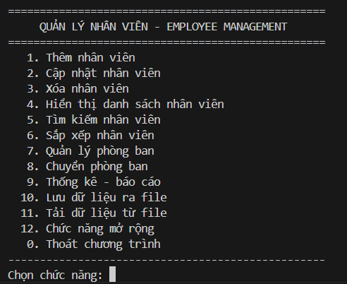
*Hình 6.1: Menu điều khiển gồm 12 chức năng và mục thoát `0`*

### 6.2. Thêm mới nhân viên
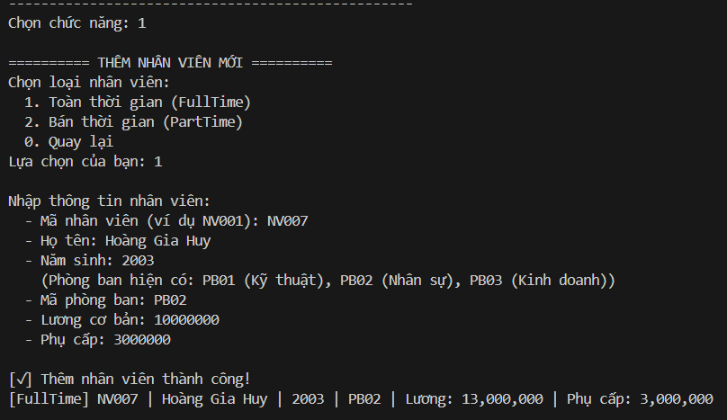
*Hình 6.2: Thêm nhân viên toàn thời gian thành công*

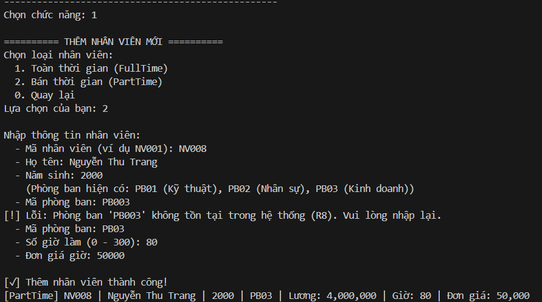
*Hình 6.3: Thêm nhân viên bán thời gian thành công (lương = số giờ × đơn giá)*

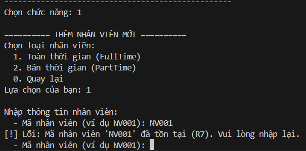
*Hình 6.4: Thêm nhân viên trùng mã bị từ chối (R7), danh sách không thay đổi*

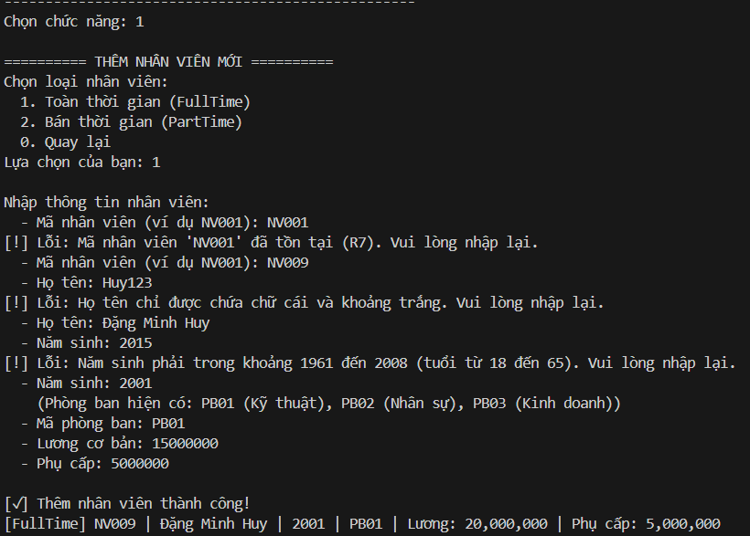
*Hình 6.5: Kiểm tra dữ liệu tức thì, nhập sai trường nào thì nhập lại đúng trường đó*

### 6.3. Cập nhật và xóa nhân viên
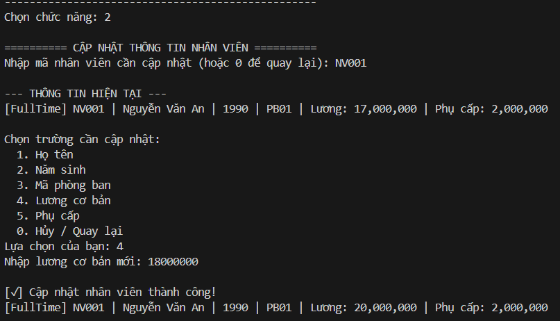
*Hình 6.6: Cập nhật thông tin nhân viên*

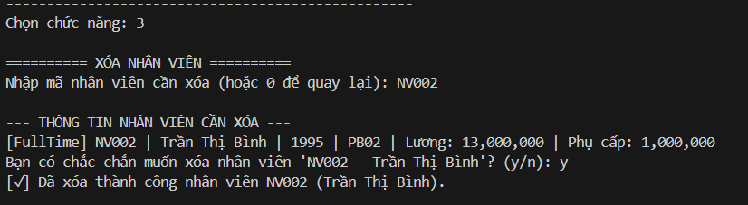
*Hình 6.7: Xóa nhân viên có bước xác nhận (nhập `n` thì hủy, nhập `y` thì xóa)*

### 6.4. Hiển thị danh sách
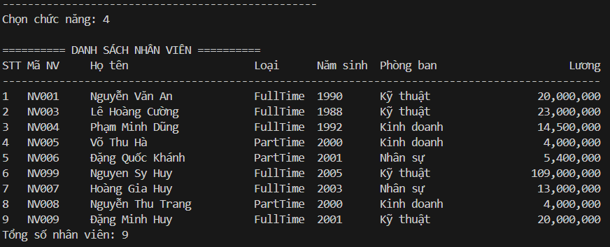
*Hình 6.8: Hiển thị danh sách dạng bảng thẳng cột, định dạng tiền tệ và hiện tên phòng ban*

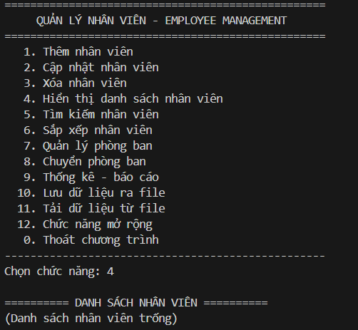
*Hình 6.9: Xử lý danh sách rỗng bằng thông báo thân thiện, không lỗi*

### 6.5. Tìm kiếm
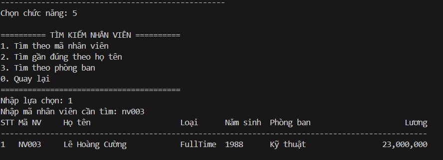
*Hình 6.10: Tìm theo mã (chính xác, không phân biệt hoa/thường)*

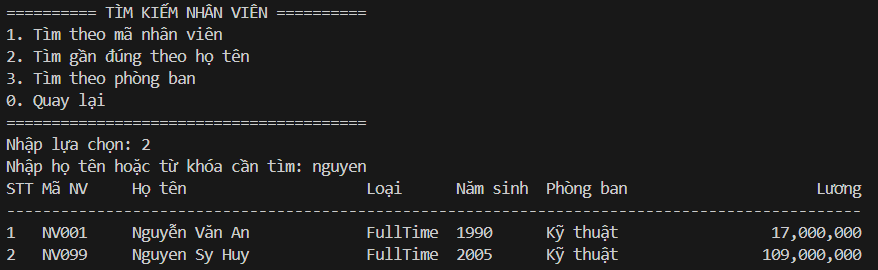
*Hình 6.11: Tìm gần đúng theo họ tên, hỗ trợ nhập không dấu*

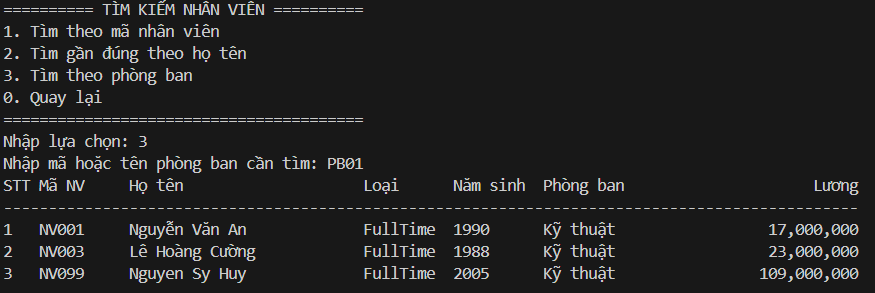
*Hình 6.12: Tìm theo phòng ban (nhập mã hoặc tên phòng ban)*

### 6.6. Sắp xếp
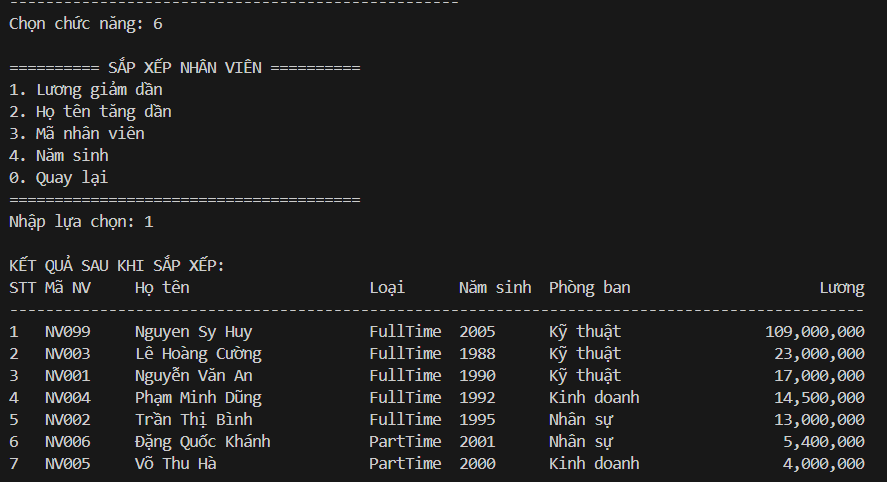
*Hình 6.13: Sắp xếp lương giảm dần*

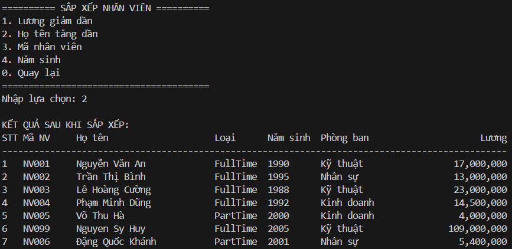
*Hình 6.14: Sắp xếp tên tăng dần (theo từ cuối của họ tên)*

### 6.7. Nghiệp vụ phòng ban

*Hình 6.15: Chuyển phòng ban thành công*


*Hình 6.16: Xóa phòng ban còn nhân viên bị từ chối, nêu rõ số nhân viên (R10)*

### 6.8. Thống kê và tình huống đa hình

*Hình 6.17: Báo cáo thống kê: tổng quỹ lương, lương cao nhất, số nhân viên theo phòng ban*


*Hình 6.18: Tình huống đa hình: cùng một danh sách có cả toàn thời gian và bán thời gian, mỗi lớp con tính lương theo công thức riêng (17,000,000 và 4,000,000)*

### 6.9. Lưu trữ và chức năng mở rộng

*Hình 6.19: Lưu dữ liệu ra file JSON và tải lại*


*Hình 6.20: Chức năng mở rộng: xuất danh sách nhân viên ra file CSV*

---

## 7. BẢNG KỊCH BẢN KIỂM THỬ HỆ THỐNG (TEST CASES)

### 7.1. Chiến lược kiểm thử
Nhóm kết hợp ba hình thức kiểm thử:
1. **Kiểm thử tự động (unit test)** bằng thư viện chuẩn `unittest`: mỗi gói có các file kiểm thử riêng trong thư mục `tests/`, chạy toàn bộ bằng `python -m unittest discover -s tests -v`.
2. **Kiểm thử thủ công qua menu** theo bảng 20 ca ở mục 7.2, bám các loại tình huống mà đề yêu cầu: dữ liệu hợp lệ, không hợp lệ, trùng mã, danh sách rỗng, ràng buộc nghiệp vụ và trường hợp biên.
3. **Kiểm thử chéo:** các ca kiểm thử thủ công được chia để mỗi thành viên chạy các ca thuộc gói của thành viên khác, nhằm phát hiện lỗi ở ranh giới giữa các gói.

### 7.2. Bảng 20 ca kiểm thử hệ thống

**[CẦN ĐIỀN: cột "Kết quả thực tế" và "Đạt / Không đạt" lấy từ `docs/test_cases.md`]**

| Mã | Loại | Chức năng | Dữ liệu vào | Kết quả mong đợi | Kết quả thực tế | Đạt / Không đạt |
|---|---|---|---|---|---|---|
| TC01 | Hợp lệ | Thêm toàn thời gian | `NV007`, `Hoàng Gia Bảo`, 1993, `PB01`, lương 14,000,000, phụ cấp 1,500,000 | Thành công; lương = 15,500,000 | | |
| TC02 | Hợp lệ | Thêm bán thời gian | `NV008`, `Lý Thu Trang`, 2001, `PB02`, 80 giờ, đơn giá 50,000 | Thành công; lương = 4,000,000 | | |
| TC03 | Trùng mã | Thêm nhân viên | Mã `NV001` (đã có) | Báo lỗi trùng mã; danh sách không đổi | | |
| TC04 | Không hợp lệ | Thêm nhân viên | Mã rỗng | Báo "Mã nhân viên không được để trống"; cho nhập lại | | |
| TC05 | Không hợp lệ | Thêm nhân viên | Họ tên `An123` | Báo họ tên chỉ được chứa chữ cái và khoảng trắng | | |
| TC06 | Biên | Thêm nhân viên | Năm sinh tương ứng đúng 18 tuổi (2008), rồi 17 tuổi (2009) | 18 tuổi hợp lệ; 17 tuổi bị từ chối | | |
| TC07 | Biên | Thêm bán thời gian | Số giờ làm 300, rồi 301 | 300 hợp lệ; 301 bị từ chối | | |
| TC08 | Không hợp lệ | Cập nhật | Lương cơ bản = -5,000,000 | Bị từ chối; dữ liệu giữ nguyên | | |
| TC09 | Ràng buộc | Cập nhật | Sửa phụ cấp của nhân viên bán thời gian | Bị từ chối (trường không áp dụng cho bán thời gian) | | |
| TC10 | Ràng buộc | Thêm nhân viên | Mã phòng ban `PB99` không tồn tại | Báo không tìm thấy phòng ban | | |
| TC11 | Ràng buộc | Xóa | Nhập `n` ở bước xác nhận | Không xóa; in thông báo đã hủy | | |
| TC12 | Không hợp lệ | Xóa và tìm | Mã `NV999` không tồn tại | Báo không tìm thấy | | |
| TC13 | Rỗng | Hiển thị | Danh sách rỗng | In "Danh sách nhân viên trống"; không lỗi | | |
| TC14 | Rỗng | Thống kê | Danh sách rỗng | Tổng quỹ lương = 0; không lỗi chia cho 0 | | |
| TC15 | Hợp lệ | Sắp xếp | Lương giảm dần | Thứ tự lương giảm dần đúng | | |
| TC16 | Hợp lệ | Sắp xếp | Tên tăng dần | Thứ tự theo tên (từ cuối) đúng | | |
| TC17 | Hợp lệ | Tìm gần đúng | Từ khóa `nguyen` | Ra các nhân viên họ Nguyễn | | |
| TC18 | Ràng buộc | Xóa phòng ban | Xóa `PB01` khi còn nhân viên | Bị từ chối; nêu số nhân viên | | |
| TC19 | Ràng buộc | Chuyển phòng ban | Chuyển `NV001` sang đúng phòng ban hiện tại | Báo đã thuộc phòng ban đó | | |
| TC20 | Ràng buộc | Lưu / Tải | Lưu file, sửa tay file JSON cho hỏng, rồi tải lại | Báo lỗi lưu trữ; chương trình không sập | | |

### 7.3. Kiểm thử tự động theo từng gói

| Gói | File kiểm thử | Tình huống tiêu biểu | Kết quả mong đợi |
|:---:|---|---|---|
| Base | `tests/test_smoke.py` | 11 kiểm thử nền tảng (lớp trừu tượng, tính lương, khứ hồi `to_dict`, menu gọi được handler, ...) | Đều đạt |
| A | `tests/test_models.py` | Tạo trực tiếp `Employee` | Ném `TypeError` (lớp trừu tượng) |
| A | `tests/test_models.py` | Toàn thời gian: lương cơ bản 15,000,000 + phụ cấp 2,000,000 | Lương = 17,000,000; chuỗi hiển thị có phụ cấp |
| A | `tests/test_models.py` | Bán thời gian: 40 giờ × 200,000 | Lương = 8,000,000; chuỗi hiển thị có số giờ và đơn giá |
| A | `tests/test_models.py` | Gán năm sinh tuổi 17, họ tên sai định dạng, lương âm, mã phòng ban sai | Các setter ném `ValidationError`; mã nhân viên chỉ đọc |
| A | `tests/test_models.py` | Chuyển nhân viên toàn thời gian sang dict rồi dựng lại qua factory | Đúng lớp `FullTimeEmployee`, cùng mức lương |
| B | `tests/test_department.py` | Thêm phòng ban trùng mã | `DuplicateIdError` (R9) |
| B | `tests/test_department.py` | Xóa phòng ban còn 2 nhân viên | `BusinessRuleError` nêu đúng số lượng; danh sách không đổi (R10) |
| B | `tests/test_department.py` | Xóa phòng ban trống | Xóa thành công, trả về đối tượng đã xóa |
| B | `tests/test_department.py` | Chuyển phòng hợp lệ / phòng đích không tồn tại / trùng phòng hiện tại | Thành công / `NotFoundError` (R11) / `BusinessRuleError` (R12) |
| B | `tests/test_department.py` | Handler: từ chối xác nhận chuyển phòng | Dịch vụ không được gọi, phòng giữ nguyên |
| C | `tests/test_employee_manager.py` | Thêm trùng mã `NV001` (TC-C01) | `DuplicateIdError`, không ghi đè |
| C | `tests/test_employee_manager.py` | Thêm vào phòng `PB99` không tồn tại (TC-C02) | `NotFoundError` (R8) |
| C | `tests/test_employee_manager.py` | Cập nhật trường bị cấm `type` (TC-C03) | `ValidationError` (R14) |
| C | `tests/test_employee_manager.py` | Cập nhật `full_name` hợp lệ cùng `base_salary=-5000` lỗi (TC-C04) | `ValidationError`; `full_name` khôi phục về tên cũ |
| C | `tests/test_employee_manager.py` | Xóa mã `NV999` không tồn tại (TC-C05) | `NotFoundError`, danh sách không đổi |
| C | `tests/test_employee_manager.py` | Gọi `clear()` trên danh sách trả về của `get_all()` (TC-C06) | Danh sách nội bộ vẫn nguyên vẹn |
| C | `tests/test_employee_manager.py` | Thêm khi danh mục phòng ban rỗng (TC-C07) | `NotFoundError`; không thêm |
| C | `tests/test_crud_handler.py` | Luồng nhập: mã sai định dạng rồi nhập đúng; mã trùng; phòng ban không tồn tại (TC-C08) | Hỏi lại tại trường sai; lỗi nghiệp vụ thì kết thúc thao tác thêm |
| D | `tests/test_search_sort.py` | `find_by_id("nv01")` | Trả về nhân viên `NV01` |
| D | `tests/test_search_sort.py` | `find_by_id("NV99")` | Trả về `None` |
| D | `tests/test_search_sort.py` | `search_by_name("nguyen")` và từ khóa rỗng | Ra `Nguyễn Văn An`; từ khóa rỗng ra `[]` |
| D | `tests/test_search_sort.py` | Sắp xếp tên tăng dần có hai người cùng tên `An` | `Hoàng Văn An` đứng trước `Nguyễn Văn An` |
| D | `tests/test_search_sort.py` | Sắp xếp lương giảm dần có hai người bằng lương | Giữ nguyên thứ tự ban đầu của hai người đó |
| D | `tests/test_search_sort.py` | Sắp xếp rồi so với bản sao ban đầu | Danh sách gốc không đổi |
| D | `tests/test_search_sort.py` | Tiêu chí sắp xếp sai (`"abc"`) | `ValidationError` |
| E | `tests/test_report.py` | Danh sách rỗng | Tổng quỹ lương `0.0`, lương trung bình `0.0`, `highest_paid` là `[]`, `count_by_type` là `{}` |
| E | `tests/test_report.py` | Hai nhân viên cùng lương cao nhất | `highest_paid` trả về cả hai |
| E | `tests/test_report.py` | Phòng ban chưa có nhân viên | Báo cáo vẫn hiện `PB03: 0` |
| E | `tests/test_storage.py` | `load()` khi chưa từng lưu | Trả về `([], [])` |
| E | `tests/test_storage.py` | File JSON hỏng, file rỗng, thiếu khóa, thiếu trường nhân viên | `StorageError`; dữ liệu hiện tại giữ nguyên |
| E | `tests/test_storage.py` | `save()` rồi `load()` | Dữ liệu giống hệt (đúng lớp, cùng lương) |

### 7.4. Kết quả tổng hợp
- Gói B ghi nhận riêng 21 kiểm thử (14 cho dịch vụ, 7 cho handler và menu) đều đạt.
- Chạy toàn bộ bộ kiểm thử: **[CẦN ĐIỀN: kết quả dòng cuối của lệnh `python -m unittest discover -s tests`, ví dụ `Ran N tests ... OK`]**.
- Bảng 20 ca ở mục 7.2: **[CẦN ĐIỀN: số ca đạt / tổng số ca; các ca không đạt (nếu có) và cách đã khắc phục]**.

---

## 8. CÁC CHỨC NĂNG MỞ RỘNG (EXTENSIONS)

Đáp ứng yêu cầu "ít nhất 02 chức năng mở rộng phù hợp chủ đề" của đề, nhóm triển khai hai chức năng sau (logic ở `storage/file_storage.py` và `ui/handlers/extension_handler.py`).

### 8.1. Chức năng mở rộng 1: Lưu và đọc dữ liệu bằng file JSON (`FileStorage`)

**Mục đích:** dữ liệu nhân sự và danh mục phòng ban không bị mất khi thoát chương trình; lần chạy sau tự nạp lại.

**Cách dùng:**
- Menu **10 – Lưu dữ liệu**: ghi toàn bộ phòng ban và nhân viên ra `data/company_data.json`, in đường dẫn file.
- Menu **11 – Tải dữ liệu**: hỏi xác nhận (vì sẽ ghi đè dữ liệu hiện tại), sau đó nạp phòng ban trước, nhân viên sau.
- Chạy `python main.py` (không `--seed`): dữ liệu đã lưu tự nạp lại.

**Cơ chế an toàn:**
- *Ghi file nguyên tử:* ghi vào file tạm rồi dùng `os.replace` để thay file thật, nên nếu ghi dở bị lỗi thì file cũ vẫn còn nguyên.
- Tự tạo thư mục `data/` nếu chưa có.
- Lỗi I/O, JSON hỏng hoặc dữ liệu sai đều quy về `StorageError`, chương trình không sập.
- Chỉ gọi `set_all()` sau khi đọc thành công, nên file hỏng không làm mất dữ liệu đang có trong bộ nhớ.

**Ví dụ kết quả khi lưu:**

```text
Chọn chức năng: 10
Đã lưu dữ liệu thành công.
File: D:\baitap\data\company_data.json
(2 phòng ban, 2 nhân viên)
```

**Cấu trúc file JSON** (có hai khóa gốc `departments` và `employees`; ghi với `ensure_ascii=False`, `indent=2` nên đọc trực tiếp được tiếng Việt):

```json
{
  "departments": [
    { "department_id": "PB01", "department_name": "Kỹ thuật" },
    { "department_id": "PB02", "department_name": "Kinh doanh" }
  ],
  "employees": [
    {
      "type": "FullTime",
      "employee_id": "NV01",
      "full_name": "Nguyễn Văn An",
      "birth_year": 1995,
      "department_id": "PB01",
      "base_salary": 10000000,
      "allowance": 2000000
    },
    {
      "type": "PartTime",
      "employee_id": "NV02",
      "full_name": "Trần Thị Bình",
      "birth_year": 2001,
      "department_id": "PB02",
      "base_salary": 0,
      "hours_worked": 80,
      "hourly_rate": 50000
    }
  ]
}
```

### 8.2. Chức năng mở rộng 2: Xuất danh sách nhân viên ra file CSV

**Mục đích:** chia sẻ danh sách cho người khác, mở và xử lý tiếp bằng Microsoft Excel hoặc Google Sheets (phục vụ công tác kế toán, báo cáo).

**Cách dùng:** chọn menu **12 – Chức năng mở rộng**. Chương trình ghi `data/employees.csv` gồm các cột: Mã NV, Họ tên, Năm sinh, Mã phòng ban, Loại, Lương cơ bản, Lương thực lĩnh. Cột "Lương thực lĩnh" là kết quả của `calculate_salary()` (lương theo công thức của từng loại nhân viên, chưa trừ thuế hay bảo hiểm).

**Cài đặt:** dùng module `csv` của thư viện chuẩn; file ghi bằng bảng mã `utf-8-sig` để Excel hiển thị đúng tiếng Việt có dấu khi mở trực tiếp.

**Ví dụ kết quả:**

```text
Đã xuất danh sách nhân viên ra CSV.
File: D:\baitap\data\employees.csv
Tổng quỹ lương: 16,000,000
```

Nội dung file CSV:

```text
Mã NV,Họ tên,Năm sinh,Mã phòng ban,Loại,Lương cơ bản,Lương thực lĩnh
NV01,Nguyễn Văn An,1995,PB01,FullTime,10000000,12000000
NV02,Trần Thị Bình,2001,PB02,PartTime,0,4000000
```

---

## 9. KẾT LUẬN VÀ HƯỚNG PHÁT TRIỂN

### 9.1. Kết quả đạt được
1. Hoàn thành các yêu cầu bắt buộc của đề: thiết kế OOP (kế thừa, đa hình, đóng gói, lớp trừu tượng), đủ các chức năng thêm, cập nhật, xóa, hiển thị, sắp xếp, tìm kiếm, nghiệp vụ nhân viên toàn thời gian/bán thời gian, chuyển phòng ban, thống kê và menu (đối chiếu chi tiết ở Phụ lục A).
2. Kiến trúc phân tầng rõ ràng (`models/`, `services/`, `storage/`, `ui/`), tách lớp thực thể khỏi lớp quản lý.
3. Kiểm soát lỗi chặt chẽ bằng hệ thống ngoại lệ tự định nghĩa; menu bắt mọi lỗi nên không bị sập khi người dùng nhập sai; cơ chế cập nhật "tất cả hoặc không gì" bảo đảm toàn vẹn dữ liệu.
4. Có hai chức năng mở rộng (lưu/đọc JSON an toàn, xuất CSV) và bộ kiểm thử tự động bao quát các gói.
5. Làm việc nhóm hiệu quả trên GitHub nhờ hợp đồng giao diện (`docs/CONTRACT.md`), nguyên tắc "một file một chủ" và quy trình Pull Request.

### 9.2. Hạn chế
- *Tìm kiếm không dấu* coi các tên chỉ khác nhau ở dấu là giống nhau (ví dụ `van` khớp cả `Văn` lẫn `Vân`). Đây là lựa chọn có chủ ý để tìm kiếm thuận tiện.
- *Sắp xếp theo tên* dựa trên mã ký tự Unicode nên các chữ có dấu như `Ă`, `Â`, `Đ` không nhất thiết theo đúng thứ tự bảng chữ cái tiếng Việt.
- *Lương bán thời gian* chỉ tính theo giờ làm và đơn giá, bỏ qua lương cơ bản; "lương thực lĩnh" khi xuất CSV chưa trừ thuế và bảo hiểm.
- Dữ liệu lưu trong một file JSON cục bộ, không mã hóa, chưa hỗ trợ nhiều người dùng đồng thời; giao diện chỉ là Console.
- Giới hạn tuổi (18–65) và số giờ làm tối đa (300) là các hằng số cố định trong mã nguồn.

### 9.3. Hướng phát triển
- Phát triển giao diện đồ họa (GUI) bằng `Tkinter` hoặc `PyQt`.
- Thay file JSON bằng hệ quản trị cơ sở dữ liệu (SQLite, PostgreSQL); do tầng lưu trữ đã tách riêng nên chỉ cần thay `FileStorage`.
- Bổ sung loại nhân viên mới (ví dụ thực tập sinh) chỉ bằng cách thêm một lớp con của `Employee`, thể hiện khả năng mở rộng của thiết kế đa hình.
- Tính lương thực nhận sau thuế thu nhập cá nhân và bảo hiểm; nhập dữ liệu hàng loạt từ CSV; xuất báo cáo Excel.
- Xây dựng phân quyền tài khoản (quản trị viên, trưởng phòng, nhân viên).

### 9.4. Bài học kinh nghiệm
- Chốt trước **hợp đồng giao diện** (tên hàm, tham số, loại lỗi) và dựng bộ khung chạy được giúp các thành viên làm song song mà không chờ nhau.
- Quy tắc "một file một chủ" cùng quy trình Pull Request và review chéo giúp nhóm, nhiều bạn mới làm quen Git, hợp nhất mã gần như không xung đột.
- Viết kiểm thử song song với mã nguồn và kiểm thử chéo giữa các thành viên giúp phát hiện sớm các lỗi ở ranh giới giữa các gói.

### 9.5. Tài liệu tham khảo
1. Python Software Foundation. *The Python Standard Library: abc, unittest, json, csv, dataclasses, unicodedata.* https://docs.python.org/3/library/
2. Python Software Foundation. *PEP 8 – Style Guide for Python Code.* https://peps.python.org/pep-0008/
3. GitHub Docs. *About pull requests; About protected branches; About code owners.* https://docs.github.com/
4. Tài liệu đề bài: *Đề bài tập lớn – Chủ đề 01: Quản lý nhân viên (Employee Management System)*, môn Lập trình Python (INT13162).

---

## PHỤ LỤC A. BẢNG ĐỐI CHIẾU YÊU CẦU ĐỀ BÀI VỚI KẾT QUẢ THỰC HIỆN

| Yêu cầu của đề | Nơi hiện thực | Minh chứng |
|---|---|---|
| UML Class Diagram (lớp, thuộc tính, phương thức, kiểu, phạm vi, quan hệ) | `docs/uml/class_diagram.drawio` | Hình 2.1; mục 2.2 |
| Lưu đồ hoạt động / menu chính | `docs/uml/activity_diagram.drawio` | Hình 2.2; mục 2.8 |
| Kế thừa (≥ 1 lớp cha, ≥ 2 lớp con) | `Employee` ← `FullTimeEmployee`, `PartTimeEmployee` | Mục 3.2 |
| Đa hình qua ghi đè phương thức | `calculate_salary()`, `to_dict()`, `__str__()` | Mục 3.3; Hình 6.18 |
| Đóng gói (thuộc tính nội bộ, property) | Thuộc tính `__x`, `@property`, setter có kiểm tra | Mục 3.1 |
| Lớp trừu tượng ABC | `Employee(ABC)` | Mục 3.4 |
| Mỗi lớp có `__init__`, `__str__` hoặc hiển thị, kiểm tra dữ liệu | Các lớp trong `models/`; `utils/validators.py` | Mục 2.3 |
| Tách lớp thực thể khỏi lớp quản lý | `Employee` và `EmployeeManager` | Mục 2.4, 2.7 |
| 1. Thêm mới (trường bắt buộc, không trùng mã) | `add_employee()`, `handle_add` | TC01–TC05; Hình 6.2–6.5 |
| 2. Cập nhật | `update_employee()`, `handle_update` | TC08, TC09; Hình 6.6 |
| 3. Xóa (xác nhận, kiểm tra dữ liệu liên quan) | `delete_employee()`, `delete_department()` | TC11, TC12, TC18; Hình 6.7, 6.16 |
| 4. Hiển thị theo cột, xử lý rỗng | `formatter`, `handle_display` | TC13; Hình 6.8, 6.9 |
| 5. Sắp xếp ≥ 2 tiêu chí, tăng/giảm | `SortService` (4 tiêu chí) | TC15, TC16; Hình 6.13, 6.14 |
| 6. Tìm kiếm mã chính xác và gần đúng | `SearchService` | TC12, TC17; Hình 6.10, 6.11 |
| 7. Nghiệp vụ đặc thù (toàn thời gian/bán thời gian, cập nhật phòng ban và lương, chuyển phòng ban, tính lương) | `FullTimeEmployee`, `PartTimeEmployee`, `transfer_employee()` | TC01, TC02, TC09, TC19; Hình 6.3, 6.15 |
| 8. Tìm theo mã/tên/phòng ban; sắp xếp lương giảm, tên tăng | `SearchService`, `SortService`, `search_sort_handler` | TC15–TC17; Hình 6.10–6.14 |
| 9. Thống kê (tổng quỹ lương, số NV theo phòng ban, lương cao nhất) | `ReportService`, `handle_report` | TC14; Hình 6.17 |
| 10. Menu (chọn chức năng, nhập lại khi sai, thoát an toàn) | `ui/menu.py` | Hình 6.1, 6.5; mục 2.8 |
| Mã nguồn có chú thích, nhiều lớp, chạy được | Toàn bộ thư mục `models/`, `services/`, `storage/`, `ui/`, `utils/` | Mục 4 |
| Báo cáo (mô tả, phân tích lớp, quan hệ OOP, hướng dẫn chạy, phân công) | Tài liệu này | Mục 1–5 |
| Ảnh chụp thêm, cập nhật, xóa, tìm kiếm, sắp xếp, thống kê, đa hình | `docs/screenshots/` | Mục 6 (20 ảnh) |
| Bảng kiểm thử ≥ 10 ca | `docs/test_cases.md` | Mục 7 (20 ca) |
| ≥ 02 chức năng mở rộng | `FileStorage`, xuất CSV | Mục 8 |

---

## PHỤ LỤC B. CẤU TRÚC THƯ MỤC DỰ ÁN

```text
employee_management/
├── main.py                      # điểm vào chương trình (--seed để nạp dữ liệu mẫu)
├── README.md
├── CONTRIBUTING.md
├── .github/
│   ├── CODEOWNERS               # chủ sở hữu từng file
│   └── pull_request_template.md
├── models/                      # tầng thực thể
│   ├── employee.py              # lớp trừu tượng Employee
│   ├── fulltime.py              # FullTimeEmployee
│   ├── parttime.py              # PartTimeEmployee
│   ├── factory.py               # employee_from_dict()
│   └── department.py            # Department
├── services/                    # tầng nghiệp vụ
│   ├── employee_manager.py
│   ├── department_service.py
│   ├── search_service.py
│   ├── sort_service.py
│   └── report_service.py
├── storage/
│   └── file_storage.py          # lưu/đọc JSON
├── ui/                          # tầng giao diện
│   ├── context.py               # AppContext
│   ├── menu.py                  # vòng lặp menu
│   └── handlers/                # crud, department, search_sort, report, extension
├── utils/
│   ├── exceptions.py
│   ├── validators.py
│   ├── input_helper.py
│   ├── formatter.py
│   └── sample_data.py
├── tests/                       # kiểm thử tự động (unittest)
├── data/                        # file dữ liệu (company_data.json, employees.csv)
└── docs/
    ├── CONTRACT.md              # hợp đồng giao diện giữa các gói
    ├── OWNERSHIP.md             # file thuộc về ai
    ├── test_cases.md            # bảng kiểm thử
    ├── uml/                     # class diagram, activity diagram
    ├── screenshots/             # 20 ảnh minh họa
    └── report/                  # báo cáo và các phần part_A ... part_E
```
