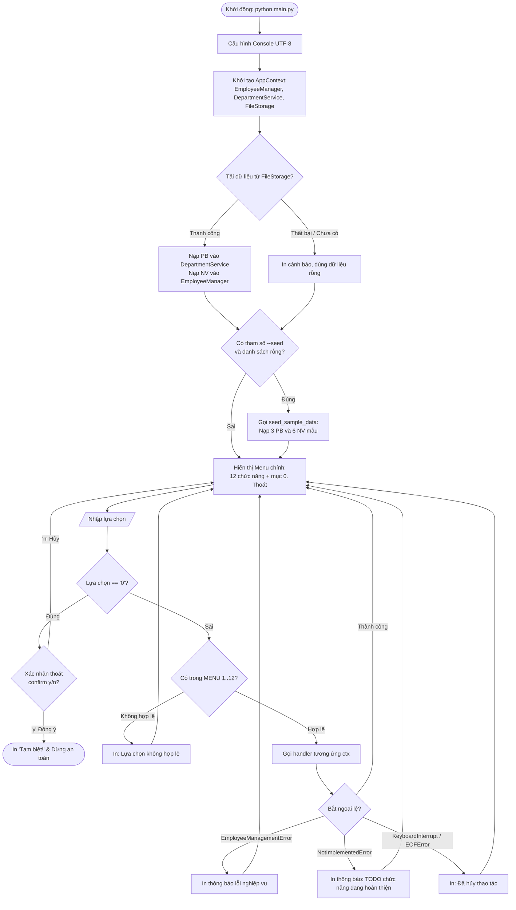
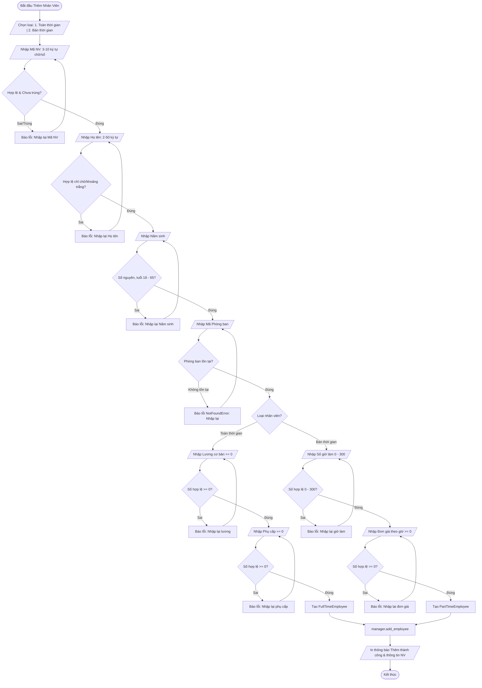
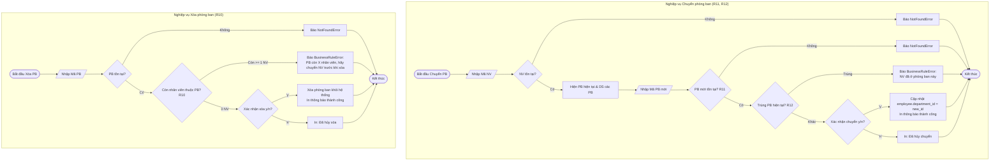

# LƯU ĐỒ HOẠT ĐỘNG (ACTIVITY DIAGRAMS / FLOWCHARTS)

> **Dự án:** Quản lý nhân viên (Employee Management System)  
> **Gói phụ trách:** Gói F – Tài liệu và Kiểm thử (Nguyễn Sỹ Huy - Nhóm trưởng)

---

## 1. Lưu đồ hoạt động Menu chính (Main Menu Flowchart)

Biểu đồ mô tả vòng đời chạy ứng dụng từ lúc khởi động, nạp dữ liệu, hiển thị menu lặp, xử lý ngoại lệ nghiệp vụ và cơ chế thoát an toàn:

---

## 2. Lưu đồ quy trình Thêm mới nhân viên (Gói C - CRUD)

Quy trình nhập liệu từng trường, kiểm tra tức thì (validate on-the-fly), lỗi ở trường nào nhập lại ngay tại trường đó mà không phải nhập lại từ đầu:

---

## 3. Lưu đồ quy trình Chuyển phòng ban & Xóa phòng ban (Gói B - Integrity Rules)

Thể hiện ràng buộc toàn vẹn dữ liệu quan hệ **R10, R11, R12**:

