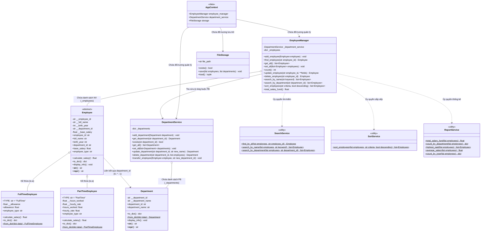

# SƠ ĐỒ LỚP UML (UML CLASS DIAGRAM)

> **Dự án:** Quản lý nhân viên (Employee Management System)  
> **Gói phụ trách:** Gói F – Tài liệu và Kiểm thử (Nguyễn Sỹ Huy - Nhóm trưởng)  
> **Ngôn ngữ thiết kế:** Python 3 (OOP)

---

## 1. Biểu đồ lớp Mermaid (Xem trực tiếp trên GitHub / Markdown)

---

## 2. Phân tích chi tiết các lớp và thực thể

### 2.1. Lớp trừu tượng `Employee` (`models/employee.py`)
- **Vai trò:** Lớp cha đại diện cho toàn bộ đối tượng nhân viên trong hệ sinh thái của công ty.
- **Tính chất OOP:**
  - **Lớp trừu tượng (Abstract Base Class - ABC):** Không cho phép khởi tạo đối tượng trực tiếp (`test_employee_is_abstract`).
  - **Đóng gói (Encapsulation):** Toàn bộ thuộc tính nghiệp vụ được bảo vệ dưới dạng `private` với tiền tố `__` (`__employee_id`, `__full_name`, `__birth_year`, `__department_id`, `__base_salary`). Quyền truy xuất và sửa đổi được kiểm soát thông qua các `@property` và setter tích hợp bộ kiểm tra dữ liệu (`validators`).
  - **Bất biến (Immutability):** `employee_id` là mã định danh duy nhất, chỉ có getter `@property`, không có setter, đảm bảo tuân thủ ràng buộc nghiệp vụ **R14**.
  - **Đa hình (Polymorphism):** Định nghĩa 2 phương thức trừu tượng `@abstractmethod`:
    + `@property employee_type`: Trả về chuỗi đại diện cho loại nhân viên (`"FullTime"` hoặc `"PartTime"`).
    + `calculate_salary()`: Phương thức tính lương mà từng lớp con bắt buộc phải cài đặt theo công thức riêng.

### 2.2. Lớp `FullTimeEmployee` (`models/fulltime.py`)
- **Vai trò:** Đại diện cho nhân viên chính thức toàn thời gian.
- **Kế thừa:** Kế thừa mọi thuộc tính và hành vi của `Employee`.
- **Đặc thù nghiệp vụ:**
  - Bổ sung thuộc tính riêng: `allowance` (phụ cấp hàng tháng, kiểm tra không âm).
  - Ghi đè (override) phương thức `calculate_salary()`:
    $$\text{Lương} = \text{base\_salary} + \text{allowance}$$
  - Đa hình hóa serialization: Bổ sung trường `allowance` khi chuyển đổi sang JSON/dict qua `to_dict()` và `from_dict()`.

### 2.3. Lớp `PartTimeEmployee` (`models/parttime.py`)
- **Vai trò:** Đại diện cho nhân viên bán thời gian tính lương theo giờ.
- **Kế thừa:** Kế thừa lớp `Employee`.
- **Đặc thù nghiệp vụ:**
  - Thuộc tính riêng: `hours_worked` (số giờ làm trong tháng, kiểm tra từ 0 đến 300) và `hourly_rate` (đơn giá theo giờ, không âm).
  - Thuộc tính `base_salary` kế thừa từ lớp cha mặc định bằng `0.0` và không tham gia vào công thức tính lương.
  - Ghi đè phương thức `calculate_salary()`:
    $$\text{Lương} = \text{hours\_worked} \times \text{hourly\_rate}$$

### 2.4. Lớp `Department` (`models/department.py`)
- **Vai trò:** Đại diện cho thực thể Phòng ban.
- **Thuộc tính:**
  - `department_id`: Mã phòng ban (chỉ đọc, viết hoa chuẩn hóa 3-10 ký tự, ví dụ `PB01`).
  - `department_name`: Tên phòng ban (2-50 ký tự, có dấu tiếng Việt).
- **Quan hệ:** Có quan hệ liên kết $1 - n$ với `Employee` thông qua khoá ngoại logic `department_id`.

### 2.5. Lớp quản lý `EmployeeManager` (`services/employee_manager.py`)
- **Vai trò:** Đóng vai trò là lớp nghiệp vụ trung tâm (Business Controller) quản lý danh sách nhân viên.
- **Tính chất OOP - Tách biệt trách nhiệm (SRP):** Tách biệt triệt để lớp thực thể dữ liệu (`Employee`) khỏi lớp logic quản lý (`EmployeeManager`).
- **Nghiệp vụ cốt lõi:**
  - `add_employee`: Kiểm tra trùng mã (R7 - `DuplicateIdError`), kiểm tra phòng ban tồn tại qua `DepartmentService` (R8 - `NotFoundError`).
  - `update_employee`: Cập nhật thông tin nhân viên theo nguyên tắc "Tất cả hoặc không gì" (Atomic update).
  - `delete_employee`: Xóa nhân viên theo mã hoặc báo lỗi nếu không tìm thấy.
  - Khối uỷ quyền (Delegation): Ủy thác các yêu cầu nghiệp vụ tìm kiếm, sắp xếp và thống kê sang các lớp dịch vụ chuyên trách (`SearchService`, `SortService`, `ReportService`).

### 2.6. Lớp quản lý `DepartmentService` (`services/department_service.py`)
- **Vai trò:** Quản lý danh mục phòng ban và xử lý các nghiệp vụ toàn vẹn dữ liệu.
- **Ràng buộc nghiệp vụ toàn vẹn:**
  - `delete_department`: Kiểm tra dữ liệu liên quan. Nếu phòng ban còn nhân viên trực thuộc thì từ chối xóa và ném `BusinessRuleError` (R10) kèm số lượng nhân viên hiện có.
  - `transfer_employee`: Thực hiện chuyển nhân viên sang phòng ban mới với kiểm tra ràng buộc phòng ban đích tồn tại (R11) và không được chuyển trùng phòng ban hiện tại (R12).

### 2.7. Các lớp dịch vụ chuyên biệt (Service Utilities)
- `SearchService`: Cung cấp các thuật toán tìm kiếm chính xác theo mã, tìm kiếm gần đúng theo họ tên (hỗ trợ tiếng Việt không dấu) và lọc theo phòng ban.
- `SortService`: Sắp xếp danh sách nhân viên theo tiêu chí đa dạng (`salary`, `name`, `id`, `birth_year`) với chiều tăng dần/giảm dần, đảm bảo tính chất thuật toán sắp xếp ổn định (Stable Sort).
- `ReportService`: Tính toán tổng quỹ lương, lương cao nhất (xử lý đồng hạng), số nhân viên theo phòng ban và theo loại hình.

---

## 3. Bảng ký hiệu phạm vi truy cập (Access Modifiers) trong thiết kế

| Ký hiệu | Phạm vi trong UML | Triển khai trong Python | Ý nghĩa kiến trúc |
|---|---|---|---|
| `-` | Private | Tên biến bắt đầu bằng `__` (name mangling) | Bảo vệ tuyệt đối bên trong lớp, không truy cập trực tiếp từ bên ngoài |
| `#` | Protected | Tên biến bắt đầu bằng `_` | Sử dụng nội bộ trong lớp và các lớp con |
| `+` | Public | Tên hàm/property thông thường | Giao diện công khai (public API) để tương tác |
| `$` | Static / Class method | `@staticmethod` hoặc `@classmethod` | Phương thức tiện ích thuộc về lớp |
| `*` | Abstract | `@abstractmethod` | Bắt buộc các lớp con phải ghi đè và cài đặt cụ thể |
